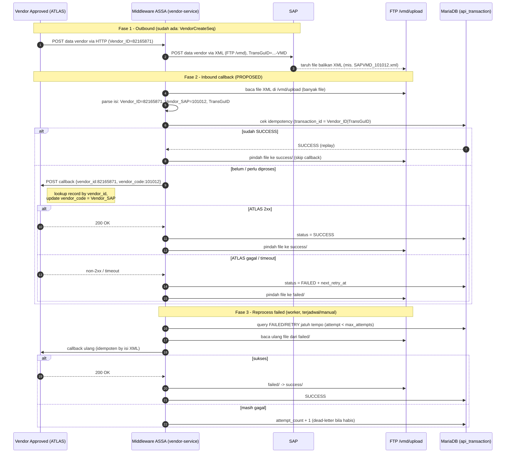

# Assignment Guide — Vendor Callback: Inbound XML dari SAP (`/vmd/upload`) + Reprocess `failed`

> **Status dokumen: PROPOSED / TO IMPLEMENT.**
> Fitur inbound/callback vendor ini **belum ada** di repository. Saat ini `vendor-service` hanya punya alur **outbound**: `POST /api/vendors/create` membentuk XML VMD lalu mengirim ke FTP folder `/vmd` (lihat `integrations/vendor-service/src/main/wso2mi/artifacts/sequences/VendorCreateSeq.xml` dan `endpoints/VendorFtpEndpoint.xml`). Tidak ada VFS listener/inbound endpoint di seluruh repo saat guide ini dibuat — semua pemakaian VFS bersifat outbound (`OUT_ONLY=true`).
>
> **Folder inbound: `/vmd/upload/`.** SAP menaruh file XML balikan di `/vmd/upload/` (dari sudut pandang SAP, file di-*upload* ke sana). Folder ini berisi **banyak** file `.xml`. **Idempotency diproses berdasarkan ISI XML (`Vendor_ID` + `TransGuID`), BUKAN nama file** — nama file bisa duplikat/menimpa dan tidak boleh dijadikan kunci keunikan.
> Guide ini **dokumentasi saja**. Tidak mengubah runtime/`.env`/deployment, dan tidak melakukan commit. Semua skeleton XML/SQL di bawah ditandai **CONTOH** dan belum ada di repo.

---

## 1. Konteks alur (sesuai diagram)

```
ATLAS (Vendor Approved)
   │  POST data vendor via HTTP
   ▼
Middleware ASSA ──────────── POST data vendor via XML (FTP /vmd) ──────────▶ SAP
   ▲                                                                          │
   │   callback response vendor_code ?                                        │
   └──────────────────────── vendor_code ◀────── file XML balikan (/vmd/upload) ◀┘
```

Alur yang diminta:

1. Middleware sudah mengirim XML vendor ke SAP (via FTP `/vmd`) — **sudah ada** (`VendorCreateSeq`).
2. Setelah SAP memproses, SAP menaruh **file XML balikan** di folder FTP `/vmd/upload/`. Folder ini berisi **banyak** file `.xml` (mis. `SAPVMD_101012.xml`, dan seterusnya).
3. Middleware harus **membaca** file-file itu, mengambil `vendor_code` (dan kunci korelasi lain) **dari isi XML**, lalu **callback ke ATLAS**.
4. Setelah file diproses:
   - sukses &rarr; dipindahkan ke folder `success`
   - gagal &rarr; dipindahkan ke folder `failed`
5. **Fokus tugas:** sediakan **mekanisme untuk memproses ulang (reprocess) file yang ada di folder `failed`**.

> Catatan grounding: pemindahan file ke `success`/`failed` di deskripsimu disebut dilakukan "oleh ATLAS". Perlu diklarifikasi (lihat keputusan terbuka #1) apakah yang memindahkan file adalah SAP, ATLAS, atau **middleware** setelah callback. Guide ini mengasumsikan **middleware** yang memindahkan file sesuai hasil callback, karena middleware yang membaca `/vmd/upload` dan memanggil ATLAS. Sesuaikan bila ternyata ATLAS/SAP yang memindahkan.

### CURRENT vs PROPOSED

| Item | Status | Bukti |
|---|---|---|
| Outbound vendor XML &rarr; FTP `/vmd` | CURRENT | `VendorCreateSeq.xml`, `VendorFtpEndpoint.xml` |
| FTP config `FTP_SAP_*` (host/port/target/user/pass) | CURRENT | `docker-compose.yml` service `vendor-service` |
| VFS **outbound** (`OUT_ONLY=true`) | CURRENT | `SafeApiCallWithRetrySeq.xml` |
| VFS **inbound / listener / polling** | PROPOSED (belum ada) | tidak ada `transport.vfs` listener / Inbound Endpoint di repo |
| Baca `/vmd/upload`, callback ATLAS | PROPOSED | — |
| Pindah file ke `success` / `failed` | PROPOSED | — |
| Reprocess folder `failed` | PROPOSED | — |
| Worker pattern (DB-driven) | CURRENT (acuan) | `RetryWorkerSeq.xml`, `WorkerAPI.xml`, `api_transaction` |

---

## 2. Tujuan bisnis

Melengkapi siklus vendor menjadi dua arah:

- **Outbound** (sudah ada): kirim data vendor ke SAP sebagai XML.
- **Inbound callback** (tugas ini): baca file balikan SAP di `/vmd/upload`, ekstrak `vendor_code` dari isi XML, callback hasilnya ke ATLAS, lalu arsipkan file ke `success`/`failed`.
- **Reprocess failed** (fokus tugas): file yang gagal diproses/callback tidak hilang — ada mekanisme untuk mencobanya lagi secara terkontrol.

---

## 3. Dua pendekatan inbound + rekomendasi

Repo belum punya VFS listener, jadi ada dua pola yang konsisten dengan arsitektur saat ini. **Keduanya bukan pilihan "salah satu" yang saling meniadakan — masing-masing paling kuat untuk peran berbeda.**

### Opsi A — VFS Inbound Endpoint (deteksi file otomatis oleh MI)

MI memiliki transport VFS yang bisa dipakai sebagai **Inbound Endpoint** untuk polling folder FTP secara periodik. Satu inbound untuk `/vmd/upload`.

- **Kelebihan:** native MI; otomatis mendeteksi & membaca file baru; punya `transport.vfs.ActionAfterProcess`/`ActionAfterFailure` = `MOVE` dengan `MoveAfterProcess`/`MoveAfterFailure` untuk memindahkan file ke `success`/`failed` tanpa kode manual; locking file bawaan transport.
- **Kekurangan:** perlu **mengaktifkan VFS listener** di deployment (`platform/docker/deployment.toml.j2`, `[transport.vfs]` saat ini default nonaktif) — keputusan deployment eksplisit; kurang cocok untuk "coba lagi dengan batas attempt & jadwal backoff"; tidak punya konsep attempt/dead-letter sendiri.

### Opsi B — Scheduled Task / Worker (dipicu, berbasis DB)

Mengikuti pola `RetryWorkerSeq` + `WorkerAPI` yang **sudah ada di repo**: sequence yang dipicu terjadwal (MI Scheduled Task) atau via endpoint HTTP, memakai `api_transaction` sebagai sumber kebenaran status.

- **Kelebihan:** konsisten dengan pola existing (`RetryWorkerSeq`, `WorkerAPI`, `api_transaction`); bisa dipicu **manual/on-demand**; punya `attempt_count`/`max_attempts`/`next_retry_at`/dead-letter langsung dari schema; kontrol penuh atas urutan & backoff.
- **Kekurangan:** untuk membaca file dari folder perlu **listing direktori FTP dari sequence**, yang **belum terbukti didukung** di MI 4.6.0 repo ini (keputusan terbuka #3); lebih banyak kode manual untuk move file dibanding Opsi A.

### Perbandingan ringkas

| Aspek | Opsi A (VFS Inbound) | Opsi B (Worker/Task) |
|---|---|---|
| Deteksi file baru otomatis | Kuat (native polling) | Perlu listing direktori (belum terbukti) |
| Pindah file ke `success`/`failed` | Bawaan (`MoveAfterProcess/Failure`) | Manual via sequence |
| Trigger manual on-demand | Lemah | Kuat (endpoint HTTP) |
| Batas attempt + backoff + dead-letter | Tidak ada bawaan | Kuat (`api_transaction`) |
| Konsisten dengan pola repo saat ini | Pola baru (listener) | Pola existing (`RetryWorkerSeq`) |
| Prasyarat deployment | Aktifkan `[transport.vfs]` | Tidak ada (reuse DB & worker) |
| Kesesuaian untuk inbound rutin | **Paling cocok** | Bisa, lebih berat |
| Kesesuaian untuk reprocess `failed` | Kurang cocok | **Paling cocok** |

### Rekomendasi (hybrid, bukan salah satu)

**Gunakan Opsi A untuk inbound rutin `/vmd/upload`, dan Opsi B untuk reprocess folder `failed`.** Pembagian ini paling cocok karena:

1. **Alur normal** butuh deteksi file otomatis & terus-menerus — kekuatan Opsi A. File yang gagal otomatis dipindah ke `failed/` oleh `MoveAfterFailure`.
2. **Reprocess `failed`** (fokus tugas ini) butuh kontrol: dipicu manual/terjadwal, batas attempt, backoff, dan dead-letter — semua itu kekuatan Opsi B lewat `api_transaction`, dan sudah ada polanya (`RetryWorkerSeq`).
3. Dua kebutuhan ini berbeda sifat (event-driven vs controlled retry), jadi memakai alat terbaik untuk masing-masing lebih sehat daripada memaksakan satu opsi untuk keduanya.

**Faktor penentu utama — cek ini lebih dulu:** apakah VFS listener boleh/dapat diaktifkan di deployment target.

- **Jika boleh** &rarr; pakai hybrid di atas (rekomendasi utama).
- **Jika tidak boleh** (atau VFS listener tidak tersedia) &rarr; Opsi B menjadi wajib untuk **keduanya**; konsekuensinya kemampuan listing direktori FTP dari sequence **harus diverifikasi lebih dulu** (keputusan terbuka #3). Bila listing juga tidak memungkinkan, inbound tidak bisa jalan tanpa Opsi A — eskalasikan ke keputusan deployment.

**Jika harus memilih hanya satu opsi** (mis. demi kesederhanaan atau kendala listener): pilih sesuai prioritas tugas. Karena fokus assignment ini adalah **memproses ulang file di folder `failed`**, maka **Opsi B** adalah pilihan tunggal yang lebih tepat — asalkan listing direktori FTP terbukti didukung. Opsi A sulit berdiri sendiri untuk reprocess terkontrol.

---

## 4. Struktur folder FTP yang diusulkan

Host & kredensial memakai variabel yang **sudah ada** di `docker-compose.yml` (`FTP_SAP_HOST`, `FTP_SAP_PORT`, `FTP_SAP_USERNAME`, `FTP_SAP_PASSWORD`). Hanya nama variabel yang disebut; jangan tulis nilai rahasia.

| Folder | Peran | Variabel path yang diusulkan |
|---|---|---|
| `/vmd` | outbound: file dikirim ke SAP (CURRENT, `FTP_SAP_TARGET`) | `FTP_SAP_TARGET` (default `/vmd`) |
| `/vmd/upload` | inbound: file balikan dari SAP yang akan diproses | `FTP_SAP_UPLOAD_DIR` (PROPOSED, mis. `/vmd/upload`) |
| `/vmd/upload/success` | arsip file yang sukses di-callback | `FTP_SAP_SUCCESS_DIR` (PROPOSED, mis. `/vmd/upload/success`) |
| `/vmd/upload/failed` | file yang gagal diproses/callback | `FTP_SAP_FAILED_DIR` (PROPOSED, mis. `/vmd/upload/failed`) |
| `/vmd/upload/processing` | staging agar tidak ada dua worker memproses file sama (opsional) | `FTP_SAP_PROCESSING_DIR` (PROPOSED) |

> Nama persis folder (`success`/`failed` relatif terhadap `/vmd/upload` atau terhadap `/vmd`) harus dikonfirmasi dengan tim SAP/ATLAS (keputusan terbuka #4).

---

## 5. Alur inbound `/vmd/upload` (callback ke ATLAS)

Urutan yang diusulkan untuk tiap file XML balikan:

1. **Ambil/baca satu file** dari `/vmd/upload`.
   - Opsi A: VFS inbound memberi konten file sebagai message.
   - Opsi B: worker listing direktori lalu baca file satu per satu; disarankan **pindahkan dulu ke `processing/`** sebelum diproses supaya tidak dobel (file-locking sederhana).
   - Nama file (mis. `SAPVMD_101012.xml`) **hanya dipakai untuk operasi file** (baca/pindah), **bukan** untuk menentukan keunikan transaksi. Beberapa file bisa punya nama sama; keunikan ditentukan dari isi XML (lihat idempotency di bawah).
2. **Parse XML balikan** dan ekstrak kunci. Berdasarkan contoh file nyata dari SAP (lihat bagian 5.1), kunci yang dipakai adalah `Vendor_ID` (= `vendor_code` di sisi ATLAS), `Vendor_SAP` (kode vendor hasil generate SAP), serta korelasi via `Header/TransGuID` + `Header/Key1 = VMD`. Perhatikan: pada contoh, `Header/DocumentNumber` **kosong**, jadi korelasi tidak boleh hanya bergantung pada `DocumentNumber` (lihat catatan idempotency di bawah).
3. **Validasi**: pastikan `vendor_code` ada dan file well-formed. Bila tidak &rarr; perlakukan sebagai gagal (ke `failed`).
4. **Callback ke ATLAS** (`POST` HTTP) membawa `vendor_code` dan status. Reuse pola endpoint HTTP + retry seperti service lain (lihat `SrToAtlasSeq.xml` sebagai contoh pemanggilan ATLAS, dan `SafeApiCallWithRetrySeq.xml` untuk pola retry). URL/credential ATLAS via config/env (mis. `ATLAS_VENDOR_CALLBACK_URL`, `ATLAS_CALLBACK_APIKEY` — PROPOSED, nama variabel saja).
5. **Catat transaksi** ke `api_transaction`/`api_transaction_log` (tabel sudah ada di `scripts/db/init_mariadb_schema.sql`) dengan `endpoint` khusus inbound (mis. `/callback/vendor`), `transaction_id` = kunci korelasi file, dan `status`.
6. **Arsipkan file**:
   - callback sukses (ATLAS 2xx) &rarr; pindah file ke `success/`, set `status=SUCCESS`.
   - callback gagal / parse gagal / ATLAS error &rarr; pindah file ke `failed/`, set `status=FAILED` + `next_retry_at`.

> **Idempotency (berbasis ISI XML, bukan nama file)**: `transaction_id` dibentuk dari **isi** XML, yaitu kombinasi `Vendor_ID` + `TransGuID` (dari contoh 5.1). **Jangan** memakai nama file (`SAPVMD_*.xml`) sebagai kunci — nama file bisa duplikat/menimpa di folder yang sama, sehingga tidak menjamin keunikan. `DocumentNumber` juga tidak boleh jadi kunci karena bisa kosong (lihat contoh 5.1).
>
> Keunikan ditegakkan via `UNIQUE KEY uq_transaction_id` pada `api_transaction` (sudah ada di schema). Alur: hitung `transaction_id` dari isi &rarr; cek apakah sudah `SUCCESS` &rarr; jika sudah, **skip callback** dan langsung arsipkan file (replay). Opsional: simpan hash/fingerprint isi XML untuk mendeteksi dua file dengan isi identik (duplikat sebenarnya) vs isi berbeda (transaksi berbeda).
>
> Konsekuensi penting: jika `Vendor_ID` + `TransGuID` **belum cukup unik** (mis. satu vendor diproses SAP beberapa kali dengan `TransGuID` sama), tambahkan komponen lain dari isi (mis. `Vendor_SAP`) ke kunci. **Komposisi final kunci idempotency harus dikonfirmasi tim SAP/ATLAS** sebelum implementasi.

### 5.1 Contoh file XML balikan dari SAP

Contoh file yang ditaruh SAP di `/vmd/upload` (satu dari banyak file `.xml` di folder tersebut, mis. bernama `SAPVMD_101012.xml`):

```xml
<?xml version="1.0" encoding="UTF-8"?>
<Transaction>
    <Header>
        <ID>AP</ID>
        <TransGuID>30.03.2026 11:50-VMD</TransGuID>
        <DocumentNumber/>
        <FileType>XML</FileType>
        <IPAddress>192.168.1.65</IPAddress>
        <DestinationUser>Web</DestinationUser>
        <Key1>VMD</Key1>
        <Key2/>
        <Key3/>
        <DataLength>1</DataLength>
    </Header>
    <TransactionDatas>
        <TransactionData>
            <Vendor_ID>82165871</Vendor_ID>
            <Vendor_SAP>101012</Vendor_SAP>
        </TransactionData>
    </TransactionDatas>
</Transaction>
```

Pemetaan field yang relevan untuk callback & korelasi:

| XPath | Contoh nilai | Peran |
|---|---|---|
| `//Transaction/TransactionDatas/TransactionData/Vendor_ID` | `82165871` | **kunci lookup** di ATLAS (dikirim ATLAS saat outbound sebagai `Vendor_ID`); dipakai untuk mencari record vendor yang akan di-update |
| `//Transaction/TransactionDatas/TransactionData/Vendor_SAP` | `101012` | **inilah `vendor_code` di sisi ATLAS** — kode vendor hasil generate SAP yang disimpan ATLAS (dikonfirmasi tim) |
| `//Transaction/Header/TransGuID` | `30.03.2026 11:50-VMD` | korelasi ke transaksi outbound (`VendorCreateSeq` membentuk `TransGuID` berakhiran `-VMD`) |
| `//Transaction/Header/Key1` | `VMD` | penanda jenis dokumen (vendor master data) |
| `//Transaction/Header/DocumentNumber` | *(kosong)* | **tidak dapat diandalkan** sebagai kunci pada contoh ini |
| `//Transaction/Header/ID` | `AP` | kode proses SAP (konfirmasi artinya ke tim SAP) |

> **Catatan grounding:** struktur ini sejalan dengan XML **outbound** `VendorCreateSeq` (`Transaction/Header` berisi `TransGuID`, `Key1`, `DocumentNumber`, dan `TransactionDatas/TransactionData` berisi `Vendor_ID`). Balikan menambahkan `Vendor_SAP`. Yang masih perlu dikonfirmasi tim SAP: apakah ada field **status** sukses/gagal di dalam XML (contoh ini tidak memuatnya) — bila tidak ada, status sukses/gagal ditentukan oleh keberhasilan callback ATLAS, bukan isi file.

### 5.2 Mekanisme callback: update `vendor_code` ke ATLAS

Ini adalah panah **"callback response vendor code"** pada diagram (Middleware ASSA &rarr; Vendor Approved/ATLAS).

> **Luruskan arah data dulu:** pada diagram, ATLAS **tidak** mengkonsumsi callback dari SAP secara langsung. SAP hanya menaruh file XML di `/vmd/upload`. **Middleware yang membaca file itu, lalu middleware yang memanggil ATLAS** (HTTP) untuk mengupdate vendor code. Jadi middleware adalah **produser** callback; ATLAS cukup menyediakan **satu endpoint penerima**. SAP tidak pernah memanggil ATLAS.

#### Apa yang dikirim ke ATLAS

Dari isi XML balikan (bagian 5.1), yang relevan untuk update di ATLAS:

- `Vendor_ID` (`82165871`) — **kunci lookup**: kode vendor yang **sudah dikenal ATLAS** (dikirim ATLAS saat `POST Data Vendor via Http` di awal). Dipakai ATLAS untuk **mencari record vendor mana** yang di-update.
- `Vendor_SAP` (`101012`) — **inilah `vendor_code` di sisi ATLAS** (dikonfirmasi tim). Kode vendor hasil generate SAP; inilah nilai yang disimpan ATLAS sebagai hasil akhir.

Jadi mapping-nya tegas:

| Peran | Field XML | Contoh |
|---|---|---|
| Kunci untuk mencari record di ATLAS | `Vendor_ID` | `82165871` |
| Nilai `vendor_code` yang di-update/disimpan ATLAS | `Vendor_SAP` | `101012` |

Semantik callback: "Record vendor dengan `Vendor_ID = 82165871` di-update `vendor_code = 101012` (dari SAP)."

#### Siapa yang memulai callback (dua pola)

| Pola | Pemicu callback ATLAS | Catatan |
|---|---|---|
| **Push oleh middleware (direkomendasikan, sesuai diagram)** | Middleware `POST` ke endpoint ATLAS setelah membaca file | Panah "callback response vendor code" di diagram = ini. Middleware aktif memanggil ATLAS. |
| **Pull oleh ATLAS** | ATLAS yang `GET` ke middleware untuk menanyakan hasil | Perlu endpoint query di middleware (mis. `GET /api/vendors/result?vendor_id=...`). Hanya bila ATLAS memang ingin menarik, bukan menerima. |

Guide ini memakai **pola push** karena cocok dengan arah panah pada diagram. Pola pull dicatat sebagai alternatif bila ATLAS lebih suka menarik data.

#### Alur push ke ATLAS (mengikuti pola `SrToAtlasSeq` yang sudah ada)

Pemanggilan ATLAS di repo ini sudah punya pola matang di `integrations/service-request-service/src/main/wso2mi/artifacts/sequences/SrToAtlasSeq.xml` + endpoint `AtlasPostEndpoint`. Pola yang sama dipakai untuk vendor callback:

1. **Resolve target ATLAS** dari config/env berlapis (env &rarr; system &rarr; file &rarr; default), **tanpa hardcode**. Nama variabel yang diusulkan (PROPOSED): `ATLAS_VENDOR_CALLBACK_URL`, `ATLAS_VENDOR_CALLBACK_PATH`, `ATLAS_VENDOR_CALLBACK_APIKEY`. (`SrToAtlasSeq` memakai `SR_TARGET_ATLAS_BASE_URL`/`_PATH`/`_API_KEY` sebagai acuan.)
2. **Bentuk payload** callback dari `Vendor_ID` + `Vendor_SAP` + status.
3. **Bersihkan header client** lalu set header ATLAS: `X-API-Key` (dari config), `Origin`, `Content-Type: application/json`, `HTTP_METHOD=POST` — persis pola `SrToAtlasSeq`.
4. **Panggil** `AtlasVendorCallbackEndpoint`, ukur durasi, baca `HTTP_SC`.
5. **Retry bila gagal**: `SrToAtlasSeq` memakai retry sampai 10x dengan jeda `DO SLEEP(1)` lewat `dbreport`. Untuk vendor callback cukup selaraskan dengan kebijakan retry/worker (bagian 6) agar konsisten dan tidak dobel-retry.
6. **Catat hasil** ke `api_transaction`/`api_transaction_log` (`DbRecordAttemptLogSeq`), set `status=SUCCESS` bila `2xx`, selain itu `FAILED` + jadwalkan reprocess.

#### Contoh payload callback (push) ke ATLAS

```json
{
  "vendor_id": "82165871",
  "vendor_code": "101012",
  "trans_guid": "30.03.2026 11:50-VMD",
  "status": "SUCCESS"
}
```

> Mapping (dikonfirmasi tim): `vendor_id` = `Vendor_ID` (kunci lookup ATLAS), `vendor_code` = `Vendor_SAP` (kode SAP yang disimpan ATLAS). Nilai sintetis. Yang masih perlu dikonfirmasi hanya **nama field final di body** (apakah ATLAS menamainya `vendor_code`/`vendorCode`/lainnya) dan apakah ATLAS memerlukan `trans_guid`/`status`.

#### Idempotency di sisi callback

- Callback ke ATLAS harus **aman diulang**: kalau middleware sudah pernah sukses update `Vendor_ID` ini (status `SUCCESS` di `api_transaction` dengan `transaction_id = Vendor_ID|TransGuID`), jangan panggil ATLAS lagi saat reprocess.
- Idealnya ATLAS juga memperlakukan callback sebagai **upsert idempoten** pada `Vendor_ID` (update berulang dengan `Vendor_SAP` sama tidak menimbulkan efek ganda). Konfirmasi ke tim ATLAS.

#### Kontrak endpoint ATLAS yang perlu dikonfirmasi

- URL + path endpoint penerima callback vendor di ATLAS.
- Method (`POST`/`PUT`/`PATCH`) dan autentikasi (`X-API-Key` seperti pola existing, atau lain).
- Nama field body persis. Mapping peran sudah tetap (dikonfirmasi tim): kunci lookup = `Vendor_ID`, nilai `vendor_code` yang di-update = `Vendor_SAP`.
- Response sukses ATLAS (2xx) dan bentuk error-nya, agar middleware bisa memutuskan `SUCCESS` vs `FAILED` &rarr; `success/`/`failed/`.

### 5.3 Diagram simulasi alur callback (dikonsumsi ATLAS)

Diagram ini mensimulasikan bagaimana `vendor_code` (= `Vendor_SAP`) sampai ke ATLAS: SAP menaruh file XML, **middleware membaca lalu push callback ke ATLAS**, dan ATLAS meng-update record vendor-nya. Termasuk jalur idempotency (replay), arsip `success`/`failed`, dan reprocess.



Poin kunci dari diagram:

- **ATLAS tidak memanggil SAP, dan SAP tidak memanggil ATLAS.** Middleware adalah perantara yang membaca file dan memanggil ATLAS.
- Yang di-update ke ATLAS adalah **`vendor_code` = `Vendor_SAP` (`101012`)**, dengan **`Vendor_ID` (`82165871`) sebagai kunci lookup**.
- Idempotency dicek **sebelum** callback (berbasis isi XML), jadi file/replay yang sudah sukses tidak memanggil ATLAS dua kali.
- File diarsipkan ke `success/` atau `failed/`; yang `failed/` masuk ke mekanisme reprocess (Fase 3).

> Diagram ini juga tersedia sebagai artifact pada sesi pembuatan guide. Jika Mermaid tidak ter-render di viewer tim, salin blok di atas ke editor Mermaid (mis. mermaid.live) atau lihat versi gambarnya.

---

## 6. Mekanisme reprocess folder `failed` (fokus tugas)

Tujuan: file yang berada di `/vmd/upload/failed` bisa diproses ulang secara terkontrol — terjadwal dan/atau manual — tanpa menduplikasi callback. Idempotency saat reprocess tetap berbasis **isi XML** (`Vendor_ID` + `TransGuID`), bukan nama file.

### 6.1 Pemicu (trigger)

Dua cara, boleh keduanya:

- **Manual / on-demand**: endpoint HTTP baru mengikuti pola `WorkerAPI` yang sudah ada.
  CONTOH: `POST /api/vendors/worker/reprocess-failed` (scope operasional, bukan `vendors` publik).
- **Terjadwal**: MI Scheduled Task memanggil sequence reprocess tiap interval (mis. tiap 5 menit), mirip semangat `RetryWorkerSeq`.

### 6.2 Dua model reprocess

**Model 1 — berbasis folder (baca ulang file di `failed/`)**
Worker melisting `failed/`, lalu untuk tiap file: pindah ke `processing/`, jalankan ulang alur bagian 5 (parse &rarr; callback ATLAS &rarr; arsip). Jika sukses &rarr; `success/`; jika masih gagal &rarr; kembalikan ke `failed/` dan naikkan counter attempt.

**Model 2 — berbasis DB (reuse pola `RetryWorkerSeq`)**
Transaksi inbound yang gagal sudah tercatat `status=FAILED` di `api_transaction` dengan `transaction_id` = `Vendor_ID|TransGuID` (dari isi XML). Worker meng-query baris `FAILED/RETRY` yang jatuh tempo (persis pola `RetryWorkerSeq` yang sudah ada), lalu memproses ulang: baca file terkait dari `failed/`, parse ulang isinya, callback ATLAS lagi, update status, pindahkan file. Simpan **isi XML** (bukan sekadar nama file) di `request_payload` agar reprocess tidak bergantung pada nama file.

> Rekomendasi: **Model 2** sebagai sumber kebenaran status + penjadwalan (karena `api_transaction` sudah punya `status`, `attempt_count`, `max_attempts`, `next_retry_at`, dan index `idx_status_next_retry`), dengan **Model 1** sebagai mekanisme membaca/ memindahkan file fisik. Keputusan final ada pada tim (keputusan terbuka #6).

### 6.3 Aturan reprocess yang harus ditetapkan

- **Batas attempt**: pakai `max_attempts` (default 3 di schema) + `attempt_count`. Setelah habis &rarr; biarkan di `failed/` dan tandai perlu intervensi manual (dead-letter), jangan loop tanpa henti.
- **Backoff**: pakai `next_retry_at` (pola `RetryWorkerSeq` memakai `DATE_ADD(NOW(), INTERVAL 300 SECOND)`). Contoh file balikan ada di bagian 5.1 untuk referensi parsing saat reprocess.
- **Locking**: pindahkan file ke `processing/` sebelum diproses supaya run terjadwal & run manual tidak berebut file yang sama.
- **Idempotency**: callback ulang untuk `vendor_code` yang sudah pernah sukses harus dicegah (cek `status=SUCCESS` di `api_transaction` sebelum callback).
- **Partial failure**: proses file satu per satu; satu file gagal tidak menghentikan file lain. Catat ringkasan di akhir run.

---

## 7. Peta artefak WSO2 MI yang harus dibuat (vendor-service)

Semua **PROPOSED** (belum ada di repo). Skeleton di bawah = **CONTOH**.

### 7.1 Endpoint callback ATLAS (BARU)

File: `integrations/vendor-service/src/main/wso2mi/artifacts/endpoints/AtlasVendorCallbackEndpoint.xml`
HTTP endpoint dinamis ke URL ATLAS (via config/env, jangan hardcode). Ini endpoint **outbound** yang dipanggil middleware untuk push `vendor_code` ke ATLAS (lihat mekanisme di bagian 5.2). Acuan pola nyata: `SrToAtlasSeq.xml` + endpoint `AtlasPostEndpoint` di `service-request-service` — reuse pola header (`X-API-Key`, `Origin`, `Content-Type`), `HTTP_METHOD=POST`, pengukuran durasi, dan logging DB.

### 7.2 Sequence inbound callback (BARU)

File: `integrations/vendor-service/src/main/wso2mi/artifacts/sequences/VendorInboundCallbackSeq.xml`

```xml
<!-- CONTOH — belum ada di repo. Skeleton alur bagian 5. -->
<?xml version="1.0" encoding="UTF-8"?>
<sequence name="VendorInboundCallbackSeq" onError="ErrorResponseSeq" xmlns="http://ws.apache.org/ns/synapse">
    <!-- 1. Message = isi file XML balikan (dari VFS inbound atau worker) -->
    <property name="inboundXml" expression="$body" scope="default"/>

    <!-- 2. Ekstrak kunci sesuai contoh XML balikan SAP (bagian 5.1) -->
    <property name="vendorId"   expression="//TransactionData/Vendor_ID"  scope="default" type="STRING"/>
    <property name="vendorSap"  expression="//TransactionData/Vendor_SAP" scope="default" type="STRING"/>
    <property name="transGuId"  expression="//Header/TransGuID"           scope="default" type="STRING"/>
    <property name="key1"       expression="//Header/Key1"                scope="default" type="STRING"/>

    <!-- 3. Validasi: Vendor_ID wajib ada; opsional pastikan Key1 = VMD -->
    <filter xpath="string-length($ctx:vendorId) = 0">
        <then>
            <property name="trxStatus" value="FAILED" scope="default" type="STRING"/>
            <!-- tandai gagal: nanti dipindah ke failed/ -->
        </then>
        <else>
            <!-- transaction_id dari ISI XML (bukan nama file): Vendor_ID + TransGuID -->
            <property name="transactionId" expression="fn:concat($ctx:vendorId, '|', $ctx:transGuId)" scope="default" type="STRING"/>
            <!-- 4. Idempotency: skip callback bila transactionId sudah SUCCESS (dblookup api_transaction) -->
            <!-- 5. Callback ATLAS: lookup pakai Vendor_ID, update vendor_code = Vendor_SAP -->
            <property name="targetEndpointKey" value="AtlasVendorCallbackEndpoint" scope="default" type="STRING"/>
            <!-- payloadFactory: { "vendor_id": $ctx:vendorId, "vendor_code": $ctx:vendorSap, "status": "SUCCESS" } -->
            <!-- 6. Catat ke api_transaction / api_transaction_log (transaction_id = Vendor_ID|TransGuID) -->
        </else>
    </filter>
</sequence>
```

### 7.3 Sequence reprocess failed (BARU) + Worker/Task

File: `integrations/vendor-service/src/main/wso2mi/artifacts/sequences/VendorReprocessFailedSeq.xml`

```xml
<!-- CONTOH — mengikuti pola shared/.../RetryWorkerSeq.xml (DB-driven) -->
<?xml version="1.0" encoding="UTF-8"?>
<sequence name="VendorReprocessFailedSeq" xmlns="http://ws.apache.org/ns/synapse">
    <!-- Query transaksi inbound vendor yang FAILED/RETRY & jatuh tempo -->
    <dblookup>
        <connection><pool>
            <driver key="conf:/repository/assa/db/driver"/>
            <url key="conf:/repository/assa/db/url"/>
            <user key="conf:/repository/assa/db/username"/>
            <password key="conf:/repository/assa/db/password"/>
        </pool></connection>
        <statement>
            <sql>SELECT transaction_id, request_payload FROM api_transaction
                 WHERE endpoint = '/callback/vendor'
                   AND status IN ('FAILED','RETRY')
                   AND attempt_count &lt; max_attempts
                   AND (next_retry_at IS NULL OR next_retry_at &lt;= NOW())
                 ORDER BY updated_at ASC LIMIT 1</sql>
            <result name="reTrxId" column="transaction_id"/>
            <result name="reFile" column="request_payload"/>
        </statement>
    </dblookup>
    <filter xpath="string-length($ctx:reTrxId) &gt; 0">
        <then>
            <!-- set RETRY + next_retry_at (pola RetryWorkerSeq: +300s) -->
            <!-- baca file dari failed/ (atau pindah ke processing/) -->
            <!-- panggil VendorInboundCallbackSeq ulang -->
            <!-- update SUCCESS -> pindah success/ ; gagal -> attempt_count+1, kembali failed/ -->
        </then>
    </filter>
</sequence>
```

File: `integrations/vendor-service/src/main/wso2mi/artifacts/apis/VendorWorkerAPI.xml`

```xml
<!-- CONTOH — mengikuti pola service-request-service/.../WorkerAPI.xml -->
<api context="/api/vendors/worker" name="VendorWorkerAPI" xmlns="http://ws.apache.org/ns/synapse">
    <resource methods="POST GET" uri-template="/reprocess-failed">
        <inSequence>
            <sequence key="VendorReprocessFailedSeq"/>
            <property name="HTTP_SC" value="200" scope="axis2" type="STRING"/>
            <payloadFactory media-type="json">
                <format>{"worker":"VendorReprocessFailed","status":"COMPLETED","timestamp":"$1"}</format>
                <args><arg evaluator="xml" expression="get-property('SYSTEM_DATE','yyyy-MM-dd HH:mm:ss')"/></args>
            </payloadFactory>
            <respond/>
        </inSequence>
        <faultSequence><sequence key="ErrorResponseSeq"/></faultSequence>
    </resource>
</api>
```

### 7.4 (Opsi A) VFS Inbound Endpoint untuk `/vmd/upload` (BARU)

```xml
<!-- CONTOH — perlu VFS listener diaktifkan di deployment.toml.
     Verifikasi parameter transport.vfs untuk MI 4.6.0 sebelum dipakai. -->
<inboundEndpoint name="VendorUploadInbound" protocol="file"
                 sequence="VendorInboundCallbackSeq" onError="ErrorResponseSeq"
                 suspend="false" xmlns="http://ws.apache.org/ns/synapse">
    <parameters>
        <parameter name="interval">60000</parameter>
        <parameter name="transport.vfs.FileURI">vfs:ftp://.../vmd/upload?vfs.passive=true</parameter>
        <parameter name="transport.vfs.ContentType">application/xml</parameter>
        <parameter name="transport.vfs.FileNamePattern">.*\.xml</parameter>
        <parameter name="transport.vfs.ActionAfterProcess">MOVE</parameter>
        <parameter name="transport.vfs.MoveAfterProcess">vfs:ftp://.../vmd/upload/success</parameter>
        <parameter name="transport.vfs.ActionAfterFailure">MOVE</parameter>
        <parameter name="transport.vfs.MoveAfterFailure">vfs:ftp://.../vmd/upload/failed</parameter>
    </parameters>
</inboundEndpoint>
```

> Karena nama file bisa duplikat, saat Opsi A memakai `MOVE` ke `success`/`failed`, pastikan strategi penamaan di folder arsip tidak saling menimpa (mis. tambahkan timestamp/`TransGuID` ke nama saat move, atau pakai subfolder per tanggal). Idempotency bisnis tetap ditegakkan di `VendorInboundCallbackSeq` berdasarkan isi XML sebelum callback, bukan dari nama file.

> Jika memakai Opsi A, pemindahan ke `success`/`failed` bisa ditangani langsung oleh VFS (`MoveAfterProcess`/`MoveAfterFailure`), sehingga middleware (bukan ATLAS) yang memindahkan file. Ini memperjelas keputusan terbuka #1.

### 7.5 Konfigurasi (UBAH/BUAT)

- `docker-compose.yml` service `vendor-service`: tambahkan variabel folder inbound (PROPOSED): `FTP_SAP_UPLOAD_DIR` (mis. `/vmd/upload`), `FTP_SAP_SUCCESS_DIR`, `FTP_SAP_FAILED_DIR`, `FTP_SAP_PROCESSING_DIR`, serta callback ATLAS: `ATLAS_VENDOR_CALLBACK_URL`, `ATLAS_CALLBACK_APIKEY`.
- `platform/docker/deployment.toml.j2`: bila Opsi A, **aktifkan VFS listener** (`[transport.vfs]`). Ini keputusan deployment eksplisit.
- `integrations/vendor-service/src/main/wso2mi/resources/conf/config.properties`: path/URL fallback (jangan commit kredensial).

---

## 8. Payload callback ATLAS (contoh)

```json
{
  "vendor_id": "82165871",
  "vendor_code": "101012",
  "trans_guid": "30.03.2026 11:50-VMD",
  "status": "SUCCESS",
  "processed_at": "2026-10-09T15:30:00+07:00"
}
```

> Mapping (dikonfirmasi tim): `vendor_id` = `Vendor_ID` (kunci lookup di ATLAS), `vendor_code` = `Vendor_SAP` (kode SAP yang disimpan ATLAS), `trans_guid` = `Header/TransGuID`. Yang masih perlu dikonfirmasi hanya **nama field di body** dan apakah ATLAS memerlukan `trans_guid`/`status`/`processed_at`. Nilai sintetis.

---

## 9. Status transaksi & arsip file

| Kondisi | `api_transaction.status` | File dipindah ke |
|---|---|---|
| XML balikan parse OK + callback ATLAS 2xx | `SUCCESS` | `success/` |
| Parse gagal / `vendor_code` kosong | `FAILED` | `failed/` |
| Callback ATLAS gagal (non-2xx / timeout) | `FAILED` (+`next_retry_at`) | `failed/` |
| Sedang diproses worker | `PROCESSING` | `processing/` (opsional) |
| Reprocess sukses | `SUCCESS` | `failed/` &rarr; `success/` |
| Reprocess habis `max_attempts` | tetap `FAILED` (dead-letter) | tetap `failed/` (perlu intervensi) |

Error response & logging ikut pola shared: `ErrorResponseSeq.xml` (`{error,message,detail}`), `LogRequestSeq`, `DbRecordAttemptLogSeq`, `DbRecordTransactionSeq`.

---

## 10. Testing lokal (saran, jangan ubah test_all.ps1 tanpa diminta)

```powershell
# Trigger manual reprocess folder failed (endpoint PROPOSED)
Invoke-RestMethod -Method Post `
  -Uri "http://localhost:8293/api/vendors/worker/reprocess-failed"
```

Skenario uji:
- `/vmd/upload` berisi banyak file valid &rarr; tiap file diproses satu per satu; callback ATLAS sukses &rarr; file pindah ke `success/`, `api_transaction.status=SUCCESS`.
- File XML rusak / tanpa `Vendor_ID` &rarr; pindah ke `failed/`, `status=FAILED`.
- ATLAS membalas error &rarr; file ke `failed/`, `next_retry_at` terisi.
- Jalankan reprocess &rarr; file di `failed/` dicoba lagi; sukses pindah ke `success/`; gagal tetap `failed/` dan `attempt_count` naik.
- Reprocess setelah `max_attempts` &rarr; file tetap `failed/`, tidak di-callback lagi (dead-letter).
- **Idempotency berbasis isi**: dua file dengan isi (`Vendor_ID` + `TransGuID`) yang sama &rarr; hanya di-callback sekali; yang kedua dikenali replay dan tidak memanggil ATLAS lagi.
- **Nama file duplikat**: dua file bernama sama (`SAPVMD_101012.xml`) tetapi isi berbeda (`TransGuID` berbeda) &rarr; keduanya diproses sebagai transaksi berbeda (bukti bahwa keunikan dari isi, bukan nama file).

---