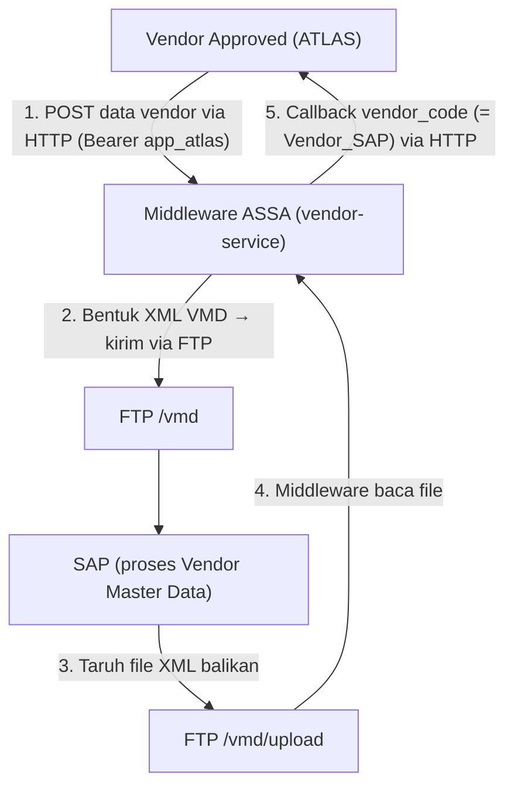
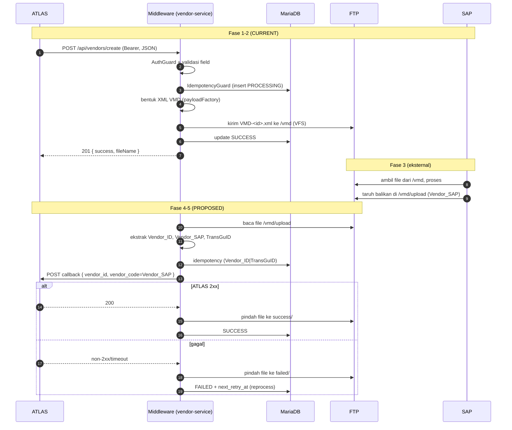

# Alur Vendor End-to-End — ATLAS → Middleware → SAP → ATLAS

> Dokumen ini menjelaskan **siklus penuh** data vendor: sejak ATLAS mengirim vendor ke Middleware, pembentukan XML & pengiriman ke SAP via FTP, pemrosesan di SAP, hingga **callback `vendor_code` kembali ke ATLAS**.
> Grounded ke artefak repo: `VendorAPI.xml`, `VendorCreateSeq.xml`, `VendorFtpEndpoint.xml`, `VendorInboundCallbackSeq.xml`, `VendorReprocessFailedSeq.xml`, `docker-compose.yml`, `deployment.toml.j2`.
> **Status:** alur **outbound** (fase 1–2) sudah terimplementasi. Alur **inbound callback** (fase 3–5) sebagian **PROPOSED** — tandai sesuai catatan di tiap fase.

---

## 1. Gambaran besar



Inti yang perlu dipahami:
- **ATLAS tidak memanggil SAP langsung**, dan **SAP tidak memanggil ATLAS**. Middleware adalah perantara dua arah.
- Arah 1–2 (outbound): ATLAS → Middleware → SAP.
- Arah 3–5 (inbound callback): SAP → file → Middleware → ATLAS.

---

## 2. Peran tiap aktor

| Aktor | Peran |
|---|---|
| **ATLAS** (`app_atlas`) | Mengirim data vendor yang sudah di-approve; menerima callback `vendor_code` hasil SAP |
| **Middleware** (`vendor-service`) | Validasi, bentuk XML, kirim FTP, baca balikan, callback ke ATLAS, catat transaksi |
| **SAP** | Memproses VMD, menghasilkan kode vendor SAP (`Vendor_SAP`), menaruh file balikan di FTP |
| **FTP server** | Media tukar file: `/vmd` (kirim ke SAP), `/vmd/upload` (balikan dari SAP) |
| **MariaDB** | Audit & idempotency (`api_transaction`, `api_transaction_log`) |

---

## FASE 1 — ATLAS mengirim vendor ke Middleware (CURRENT)

ATLAS memanggil endpoint vendor dengan Bearer token:

```
POST /api/vendors/create
Authorization: Bearer <ATLAS_TOKEN>
Content-Type: application/json
X-Transaction-Id: <idempotency-key>
```

Routing: `VendorAPI.xml` (context `/api/vendors`, resource `POST /create`):
1. Set `requiredScope = vendors`.
2. Panggil `AuthGuardSeq` → validasi token & scope (`401`/`403` bila gagal), set `X-Correlation-Id`.
3. Delegasi ke `VendorCreateSeq`.

Field body wajib (dari `VendorCreateSeq.xml`): `Vendor_ID`, `Company_Name`, `Vendor_Type`, `Account_Number`, `Account_Name`, `Bank_Name`, `HO_Email`, `HO_Phone`, `HO_Address`, `NPWP`, `Account_Group` (enum `V010/V020/V030`), `TOP`, `GL_Account`, `DocumentNumber`.

---

## FASE 2 — Middleware bentuk XML & kirim ke SAP via FTP (CURRENT)

Di `VendorCreateSeq.xml`:

1. **Ekstraksi & validasi** tiap field (cek wajib + batas panjang; `400` bila gagal).
2. **Observability & idempotency**: `LogRequestSeq` lalu `IdempotencyGuardSeq` (cek `api_transaction` → replay bila sudah SUCCESS, `409` bila PROCESSING, insert PROCESSING bila baru).
3. **Bentuk XML VMD** via `payloadFactory` (aman dari XML injection, `evaluator="xml"`). Struktur:
   ```xml
   <Transaction>
     <Header>
       <ID>ATLAS</ID>
       <TransGuID>yyyy-MM-dd HH:mm:ss-VMD</TransGuID>
       <DocumentNumber>...</DocumentNumber>
       <FileType>XML</FileType>
       <Key1>...</Key1>
       <Key2>VMD</Key2>
       ...
     </Header>
     <TransactionDatas>
       <TransactionData>
         <Vendor_ID>82165871</Vendor_ID>
         <Company_Code>...</Company_Code>
         <Company_Name>...</Company_Name>
         ... (field vendor lainnya)
       </TransactionData>
     </TransactionDatas>
   </Transaction>
   ```
4. **Nama file**: `VMD-<Vendor_ID>-<tanggal>.xml` (pola di `VendorCreateSeq`).
5. **Resolusi tujuan FTP** berlapis (ENV `FTP_SAP_*` → system → file → fallback). Default dari `docker-compose.yml`: host `devqaxmlpool.assa.id`, port `21`, folder `/vmd`.
6. **Kirim** via `VendorFtpEndpoint` (VFS, `OUT_ONLY=true`) dengan URI:
   ```
   vfs:ftp://<user>:<pass>@<host>:<port>/<dir>?vfs.passive=true
   ```
   `transport.vfs.ReplyFileName` = nama file.
7. **Catat transaksi** SUCCESS + response `201` ke ATLAS:
   ```json
   { "success": true, "message": "Payload accepted and delivered", "transactionId": "...", "fileName": "VMD-82165871-....xml" }
   ```

> Catatan: pada fase ini "sukses" berarti **file terkirim ke FTP**, belum tentu SAP sudah selesai memproses. Hasil akhir SAP datang di fase 3–5.

---

## FASE 3 — SAP memproses & menaruh file balikan (eksternal)

SAP mengambil file dari `/vmd`, memproses Vendor Master Data, lalu **menaruh file XML balikan** di folder FTP `/vmd/upload` (banyak file `.xml`, mis. `SAPVMD_101012.xml`).

Contoh isi file balikan SAP (terverifikasi dari contoh nyata):

```xml
<?xml version="1.0" encoding="UTF-8"?>
<Transaction>
  <Header>
    <ID>AP</ID>
    <TransGuID>30.03.2026 11:50-VMD</TransGuID>
    <DocumentNumber/>
    <FileType>XML</FileType>
    <IPAddress>192.168.1.65</IPAddress>
    <DestinationUser>Web</DestinationUser>
    <Key1>VMD</Key1>
    <Key2/>
    <Key3/>
    <DataLength>1</DataLength>
  </Header>
  <TransactionDatas>
    <TransactionData>
      <Vendor_ID>82165871</Vendor_ID>
      <Vendor_SAP>101012</Vendor_SAP>
    </TransactionData>
  </TransactionDatas>
</Transaction>
```

Field kunci dari balikan:

| Field | Contoh | Peran |
|---|---|---|
| `Vendor_ID` | `82165871` | kunci lookup di ATLAS (dikirim ATLAS di fase 1) |
| `Vendor_SAP` | `101012` | **`vendor_code` di sisi ATLAS** — kode hasil generate SAP |
| `TransGuID` | `30.03.2026 11:50-VMD` | korelasi ke transaksi outbound |

> `DocumentNumber` bisa kosong di balikan → jangan dijadikan kunci korelasi.

---

## FASE 4 — Middleware baca file & callback ke ATLAS (PROPOSED)

Di `VendorInboundCallbackSeq.xml` (per file XML balikan):

1. **Ekstrak isi**: `Vendor_ID`, `Vendor_SAP`, `TransGuID` dari XML (`//TransactionData/Vendor_ID`, dst).
2. **Idempotency berbasis isi** (bukan nama file): `transaction_id = Vendor_ID|TransGuID`. Cek `api_transaction` → bila sudah `SUCCESS`, skip callback (replay); bila baru, insert PROCESSING.
3. **Callback ke ATLAS** via `Hc/Atlas endpoint` (POST), payload:
   ```json
   { "vendor_id": "82165871", "vendor_code": "101012", "trans_guid": "30.03.2026 11:50-VMD", "status": "SUCCESS" }
   ```
   di mana `vendor_code = Vendor_SAP` (lookup ATLAS pakai `vendor_id = Vendor_ID`).
4. **Catat hasil** ke `api_transaction` / `api_transaction_log`:
   - ATLAS 2xx → `SUCCESS`, file dipindah ke `/vmd/upload/success`.
   - ATLAS gagal/timeout → `FAILED` + `next_retry_at`, file dipindah ke `/vmd/upload/failed`.

> Pembacaan file bisa via VFS Inbound Endpoint (polling otomatis) atau worker terjadwal — lihat guide callback vendor untuk pilihan Opsi A/B.

---

## FASE 5 — Reprocess file gagal (PROPOSED)

File di `/vmd/upload/failed` diproses ulang oleh `VendorReprocessFailedSeq.xml` (pola `RetryWorkerSeq`):

1. Query `api_transaction` status `FAILED/RETRY` yang jatuh tempo (`attempt_count < max_attempts`, `next_retry_at <= NOW()`).
2. Baca ulang isi XML (disimpan di `request_payload`), panggil ulang callback ATLAS.
3. Sukses → `SUCCESS`, file ke `success/`. Masih gagal → `attempt_count+1`; habis attempt → dead-letter (tetap di `failed/`).

Trigger: manual `POST /api/vendors/worker/reprocess-failed` dan/atau terjadwal.

---

## 6. Diagram sequence lengkap



---

## 7. Ringkasan folder & status

| Folder FTP | Isi | Fase |
|---|---|---|
| `/vmd` | File VMD dikirim middleware ke SAP | 2 (CURRENT) |
| `/vmd/upload` | File balikan SAP yang akan diproses | 3–4 (PROPOSED) |
| `/vmd/upload/success` | Arsip file yang berhasil callback ke ATLAS | 4 |
| `/vmd/upload/failed` | File gagal → direprocess | 4–5 |
| `/vmd/upload/processing` | Staging anti dobel (opsional) | 4–5 |

| Fase | Status |
|---|---|
| 1. ATLAS → Middleware | CURRENT (terimplementasi) |
| 2. Middleware → SAP (XML/FTP) | CURRENT |
| 3. SAP → file balikan | eksternal (SAP) |
| 4. Middleware baca → callback ATLAS | PROPOSED |
| 5. Reprocess failed | PROPOSED |

---

## 8. Catatan & referensi

- **Mapping penting:** `vendor_code` (ATLAS) = `Vendor_SAP` (balikan SAP); `Vendor_ID` = kunci lookup.
- **Idempotency:** berbasis isi XML (`Vendor_ID` + `TransGuID`), bukan nama file (nama bisa duplikat).
- **Keamanan:** token via env (`AUTH_APP_ATLAS_TOKEN`), FTP credential via secret — jangan commit. Lihat `SECURITY_REVIEW.md` (FTP plain port 21 direkomendasikan migrasi ke SFTP/FTPS).
- **Detail implementasi callback & reprocess:** lihat guide callback vendor inbound dan `GUIDE_VENDOR_CREATE_XML_FTP_V2.md`.

### File acuan (repo)
- `integrations/vendor-service/.../apis/VendorAPI.xml`
- `integrations/vendor-service/.../sequences/VendorCreateSeq.xml`
- `integrations/vendor-service/.../endpoints/VendorFtpEndpoint.xml`
- `integrations/vendor-service/.../sequences/VendorInboundCallbackSeq.xml`
- `integrations/vendor-service/.../sequences/VendorReprocessFailedSeq.xml`
- `shared/.../AuthGuardSeq.xml`, `IdempotencyGuardSeq.xml`
- `docker-compose.yml`, `platform/docker/deployment.toml.j2`
