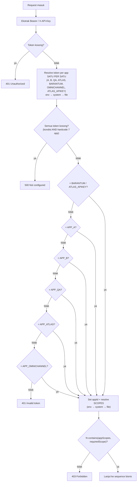
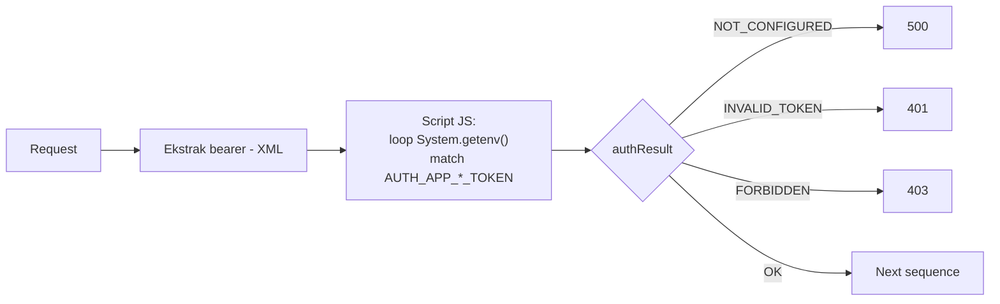
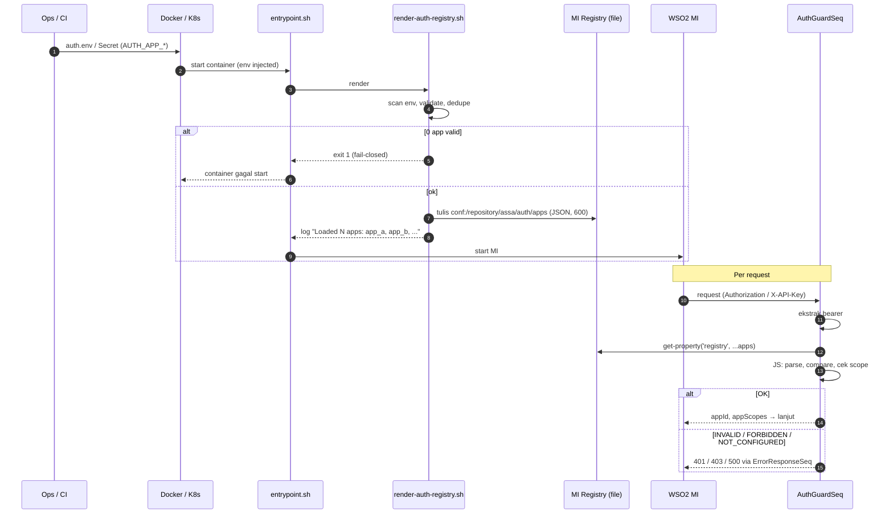
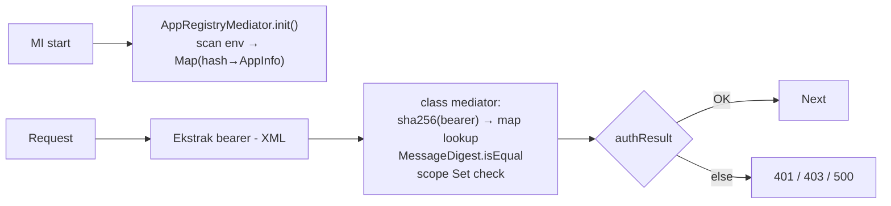
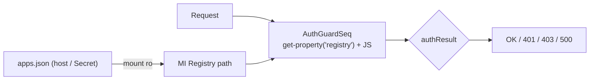
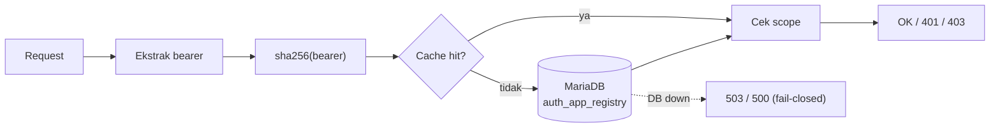
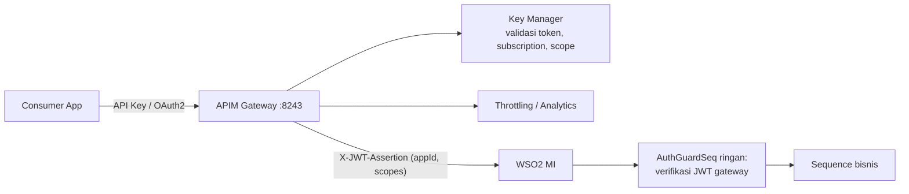
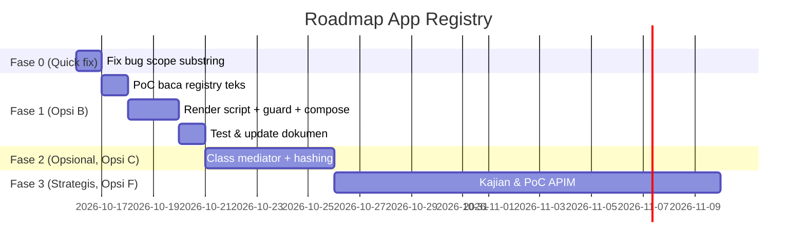

# 🔐 Proposal: Dynamic App Registry untuk `AuthGuardSeq`

> **Status:** DRAFT — untuk didiskusikan dengan Tim Dev & Tech Lead
> **Scope:** `shared/src/main/wso2mi/artifacts/sequences/AuthGuardSeq.xml`, `docker-compose.yml`, `platform/docker/*`, `platform/k8s/*`
> **Runtime:** WSO2 Micro Integrator 4.6.0 (Docker image `wso2/wso2mi:4.6.0`)
> **Tujuan:** Menambah aplikasi konsumen baru (app C, D, E, …) **cukup lewat konfigurasi (env / docker-compose / k8s secret)**, tanpa mengubah XML dan tanpa build ulang CAR.

---

## Daftar Isi

1. [Ringkasan Eksekutif (TL;DR)](#1-ringkasan-eksekutif-tldr)
2. [Kondisi Saat Ini & Masalahnya](#2-kondisi-saat-ini--masalahnya)
3. [Prinsip Desain (Cara Berpikir)](#3-prinsip-desain-cara-berpikir)
4. [Konvensi Konfigurasi yang Diusulkan](#4-konvensi-konfigurasi-yang-diusulkan)
5. [Opsi-Opsi Solusi](#5-opsi-opsi-solusi)
   - [Opsi A — Script Mediator membaca env langsung](#opsi-a--script-mediator-membaca-env-langsung)
   - [Opsi B — Entrypoint render registry + Script Mediator (⭐ Rekomendasi Fase 1)](#opsi-b--entrypoint-render-registry--script-mediator--rekomendasi-fase-1)
   - [Opsi C — Class Mediator Java](#opsi-c--class-mediator-java)
   - [Opsi D — File JSON di-mount (volume / secret)](#opsi-d--file-json-di-mount-volume--secret)
   - [Opsi E — Registry di Database (MariaDB)](#opsi-e--registry-di-database-mariadb)
   - [Opsi F — Delegasi ke WSO2 API Manager](#opsi-f--delegasi-ke-wso2-api-manager)
6. [Matriks Perbandingan](#6-matriks-perbandingan)
7. [Rekomendasi & Roadmap](#7-rekomendasi--roadmap)
8. [Rencana Implementasi Opsi B (Detail)](#8-rencana-implementasi-opsi-b-detail)
9. [Strategi Testing](#9-strategi-testing)
10. [Keamanan, Observability & Operasional](#10-keamanan-observability--operasional)
11. [Rollback Plan](#11-rollback-plan)
12. [SOP Menambah Aplikasi Baru (Setelah Implementasi)](#12-sop-menambah-aplikasi-baru-setelah-implementasi)
13. [Temuan Tambahan (Wajib Diperbaiki Terlepas dari Opsi)](#13-temuan-tambahan-wajib-diperbaiki-terlepas-dari-opsi)
14. [Open Questions untuk Tech Lead](#14-open-questions-untuk-tech-lead)

---

## 1. Ringkasan Eksekutif (TL;DR)

| Item | Isi |
| :--- | :--- |
| **Masalah** | Setiap app baru butuh edit `AuthGuardSeq.xml` di 3–4 tempat + edit `docker-compose.yml` + build CAR + redeploy. Nesting `filter/else` sudah 6 level dan terus bertambah. |
| **Ide inti** | Jadikan **konvensi nama env** (`AUTH_APP_<ID>_TOKEN` / `AUTH_APP_<ID>_SCOPES`) sebagai *registry*. Guard tidak lagi menyebut app satu per satu, tapi **menemukan** app secara dinamis. |
| **Rekomendasi Fase 1** | **Opsi B** — script entrypoint (yang polanya *sudah ada & terverifikasi* untuk DB secret) me-render env `AUTH_APP_*` menjadi 1 resource registry JSON saat container start. `AuthGuardSeq` cukup parse JSON tersebut dengan script mediator (pola JS sudah dipakai di project). |
| **Fase 2 (opsional)** | **Opsi C** (Class Mediator Java) bila butuh token hashing, expiry, rotasi lanjutan, performa maksimum. Konvensi env **tetap sama** → tidak ada perubahan bagi ops. |
| **Fase 3 (strategis)** | **Opsi F** (WSO2 APIM, sudah ada di compose) bila jumlah konsumen besar, butuh self-service, rate limiting, analytics. |
| **Hasil akhir** | Tambah app = tambah 2 baris di `auth.env` (atau k8s Secret) → `docker compose up -d` / `kubectl rollout restart`. **0 baris XML.** |

---

## 2. Kondisi Saat Ini & Masalahnya

### 2.1 Alur saat ini



### 2.2 Titik perubahan setiap menambah 1 app

| # | Lokasi | Perubahan |
| :-: | :--- | :--- |
| 1 | `AuthGuardSeq.xml` (blok resolve token) | +4 baris (env → system → file) |
| 2 | `AuthGuardSeq.xml` (fail-closed, baris ~94) | Tambah `and string-length(...) = 0` |
| 3 | `AuthGuardSeq.xml` (chain matching) | Tambah 1 level `filter/then/else` baru + 3 baris resolve scopes |
| 4 | `docker-compose.yml` | +2 baris (`_TOKEN`, `_SCOPES`) |
| 5 | `.env.example`, `config.properties`, dokumen | Update |
| 6 | Build & deploy | `mvn package` → CAR baru → rebuild image **semua service** (karena `shared` CAR ikut semua image) |

### 2.3 Dampak

- **Maintainability:** kompleksitas tumbuh linear per app; nesting makin dalam → rawan salah tutup tag & sulit di-review.
- **Lead time:** perubahan konfigurasi (bisnis) memerlukan siklus rilis kode.
- **Risiko:** tiap edit guard = risiko regresi pada **semua** endpoint (guard dipakai seluruh API).
- **Inkonsistensi dokumen:** `test/APP_REGISTRY_GUIDE.md` §2 menyatakan "cukup tambahkan entri ke `config.properties`", padahal kenyataannya tidak cukup.
- **Bug laten:** pengecekan scope memakai `fn:contains` (substring), lihat [§13](#13-temuan-tambahan-wajib-diperbaiki-terlepas-dari-opsi).

---

## 3. Prinsip Desain (Cara Berpikir)

Keputusan di dokumen ini diturunkan dari prinsip berikut. Gunakan ini sebagai "kacamata" saat menilai opsi.

| Prinsip | Artinya untuk kasus ini |
| :--- | :--- |
| **Open/Closed Principle** | Guard harus *tertutup terhadap modifikasi* tapi *terbuka untuk ekstensi*. Menambah app = menambah data, bukan menambah kode. |
| **Config as Data** | Daftar app adalah **data**, bukan **logika**. Data tinggal di layer konfigurasi (env/secret), logika tinggal di CAR. |
| **Convention over Configuration** | Pakai konvensi nama yang **sudah dipakai** (`AUTH_APP_<ID>_TOKEN`) agar migrasi tanpa mengubah `.env` existing. |
| **12-Factor (Config in Environment)** | Konfigurasi per-environment (dev/QA/prod) disuntik via env/secret, sama untuk Docker Compose & Kubernetes. |
| **Fail-Closed** | Jika registry kosong/rusak → tolak (500/startup gagal), **bukan** loloskan request. |
| **Single Source of Truth** | Satu sumber token (env/secret). Hindari fallback berlapis (env → system → file) yang membuat sulit dilacak "token mana yang sebenarnya aktif". |
| **Least Privilege** | App tanpa `SCOPES` = tidak punya akses apa pun (bukan akses penuh). |
| **Reuse pola yang sudah terbukti** | Project sudah punya `render-registry-secrets.sh` (env → registry, verified MI 4.6.0) dan script mediator JS (`GenericPaginationSeq`). Memakai pola yang sama menurunkan risiko & kurva belajar. |
| **Reversible** | Pilih langkah yang mudah di-rollback dan bisa di-upgrade bertahap (B → C → F) tanpa mengubah kontrak ke konsumen. |

---

## 4. Konvensi Konfigurasi yang Diusulkan

Konvensi ini **berlaku untuk Opsi A, B, C** (dan bisa jadi format input D/E). Kompatibel 100% dengan `.env` existing.

| Env Var | Wajib | Contoh | Keterangan |
| :--- | :-: | :--- | :--- |
| `AUTH_APP_<ID>_TOKEN` | ✅ | `3e37…5013` | Token bearer. Boleh **lebih dari satu dipisah koma** (untuk rotasi tanpa downtime / alias). |
| `AUTH_APP_<ID>_SCOPES` | ⚠️ | `branches,customers` | Daftar scope dipisah koma. `*` = semua scope. Jika kosong → app terautentikasi tapi **tidak punya akses** (403 di semua endpoint ber-scope). |
| `AUTH_APP_<ID>_NAME` | ❌ | `Portal Internal ASSA` | Nama human-readable untuk log/audit. |
| `AUTH_APP_<ID>_ENABLED` | ❌ | `false` | Default `true`. Set `false` untuk menonaktifkan app tanpa menghapus token (kill-switch). |

**Aturan `<ID>`:**
- Regex: `[A-Z0-9_]+` (huruf besar, angka, underscore). Contoh: `A`, `QA`, `SALES_PORTAL`.
- `appId` yang diset ke message context = `app_` + lowercase(`<ID>`) → `AUTH_APP_SALES_PORTAL_TOKEN` ⇒ `appId = app_sales_portal`.
- Ini **sama persis** dengan `appId` yang sekarang (`app_a`, `app_b`, `app_qa`, `app_atlas`, `app_barantum`, `app_omnichannel`) → log/DB/audit existing tidak terpengaruh.

**Aturan token:**
- Karakter yang diizinkan: `A-Z a-z 0-9 . _ ~ + / = -` (tanpa koma, spasi, kutip).
- Panjang minimal 16 karakter (disarankan 64 hex / 32 byte random: `openssl rand -hex 32`).
- Token **tidak boleh** sama antar dua app berbeda (divalidasi saat render — lihat Opsi B).

**Contoh `auth.env`:**

```properties
AUTH_APP_A_TOKEN=3e378f89...
AUTH_APP_A_SCOPES=branches,customers,vehicles

AUTH_APP_BARANTUM_TOKEN=umk_2d35...,ik4lcTGs...     # 2 token: utama + alias
AUTH_APP_BARANTUM_SCOPES=service_requests

# App baru → cukup tambah ini
AUTH_APP_SALES_PORTAL_TOKEN=9a1b...
AUTH_APP_SALES_PORTAL_SCOPES=customers
AUTH_APP_SALES_PORTAL_NAME=Sales Portal
```

---

## 5. Opsi-Opsi Solusi

Setiap opsi dijelaskan dengan format: **Konsep → Cara Kerja → Flow → Required → Implementasi → Kelebihan/Kekurangan → Risiko → Effort**.

> [!NOTE]
> Estimasi effort adalah perkiraan kasar (person-day) untuk 1 developer yang familiar dengan WSO2 MI, termasuk testing lokal, belum termasuk antrian review/UAT.

---

### Opsi A — Script Mediator membaca env langsung

#### Konsep
Ganti seluruh blok resolve + chain matching dengan **satu** `<script language="js">` yang meng-iterasi `System.getenv()` di runtime, mencari key `AUTH_APP_*_TOKEN` yang nilainya cocok dengan bearer.

#### Cara Kerja
1. XML tetap mengekstrak `bearerToken` (bagian ini tidak berubah).
2. JS memanggil `java.lang.System.getenv()` (Java interop dari GraalJS).
3. Loop semua env; untuk key yang cocok regex `^AUTH_APP_(.+)_TOKEN$`, bandingkan nilainya dengan bearer.
4. Jika cocok → set `appId`, `appScopes`; cek scope; set `authResult`.
5. XML `switch` pada `authResult` → 500 / 401 / 403 / lanjut.

#### Flow



#### Required
- GraalJS di MI 4.6.0 **mengizinkan host class access** (`Java.type('java.lang.System')` atau `java.lang.System`). **Belum terverifikasi** — wajib PoC.
- Tidak ada perubahan Dockerfile/entrypoint.
- Compose: pindah ke `env_file` (lihat [§8.4](#84-perubahan-docker-composeyml)).

#### Implementasi (sketsa)

```xml
<script language="js"><![CDATA[
    var System = Java.type('java.lang.System');
    var env = System.getenv();            // java.util.Map
    var it = env.keySet().iterator();
    // ... loop, match regex, compare (lihat logic lengkap di Opsi B §8.3)
]]></script>
```

#### Kelebihan
- Perubahan paling kecil: hanya 1 file XML.
- Tidak menyentuh entrypoint / image.

#### Kekurangan
- **Bergantung pada host access GraalJS** — WSO2 bisa membatasi ini (security hardening) di versi tertentu/patch berikutnya → risiko "tiba-tiba rusak saat upgrade MI".
- Iterasi seluruh env (puluhan var) **di setiap request**.
- Validasi konfigurasi (token duplikat, format salah) baru ketahuan saat request, bukan saat startup.
- Sulit di-unit test.

#### Risiko
🟠 **Medium** — blocker teknis potensial (host access). Jika PoC gagal, opsi ini gugur.

#### Effort
~1–1,5 hari (termasuk PoC).

---

### Opsi B — Entrypoint render registry + Script Mediator (⭐ Rekomendasi Fase 1)

#### Konsep
Pisahkan **"menemukan app"** (dilakukan **sekali** saat container start, di shell/python) dari **"memvalidasi request"** (dilakukan per request di MI).

- Saat start, script entrypoint membaca semua env `AUTH_APP_*`, memvalidasi, lalu menulis **1 file JSON** ke registry MI: `conf:/repository/assa/auth/apps`.
- `AuthGuardSeq` membaca resource registry itu (string JSON), lalu JS **murni** (tanpa Java interop) mencocokkan token & scope.

Ini **pola yang sama persis** dengan `platform/docker/render-registry-secrets.sh` yang sudah merender `DB_USERNAME/DB_PASSWORD` ke `conf:/repository/assa/db/*` dan **sudah terverifikasi di MI 4.6.0**.

#### Cara Kerja

**Fase startup (sekali per container):**
1. `entrypoint.sh` memanggil `render-auth-registry.sh` (baru) sebelum MI start.
2. Script (python3 — sudah tersedia di image, dipakai oleh DB forwarder) memindai `os.environ`.
3. Validasi: format `<ID>`, format & panjang token, token duplikat antar app, scope kosong (warning).
4. Tulis `registry/config/repository/assa/auth/apps` (JSON, `chmod 600`).
5. Log ringkasan: jumlah app + daftar `appId` + jumlah scope (**tanpa token**).
6. Jika 0 app & `AUTH_REQUIRE_APPS=true` (default) → `exit 1` → container gagal start (**fail-closed di boot**).

**Fase request:**
1. XML ekstrak `bearerToken` (tidak berubah).
2. `<property expression="get-property('registry','conf:/repository/assa/auth/apps')">` → string JSON.
3. JS: `JSON.parse`, loop app, *constant-time compare* tiap token, cek scope (exact match per item, bukan substring).
4. JS set `appId`, `appScopes`, `appName`, `authResult`.
5. XML `switch` pada `authResult`.

#### Flow



#### Required
| Kebutuhan | Status |
| :--- | :--- |
| `python3` di image MI | ✅ Sudah ada (dipakai DB forwarder di `entrypoint.sh`) |
| Pola render ke `registry/config/repository/...` | ✅ Sudah ada & terverifikasi (`render-registry-secrets.sh`) |
| Script mediator JS (GraalJS) | ✅ Sudah dipakai (`GenericPaginationSeq`, `SpkDuelistSeq`, `VehicleGetByLicensePlateSeq`) |
| `JSON.parse` di GraalJS | ✅ Standar ECMAScript, tanpa Java interop |
| `get-property('registry', key)` mengembalikan konten resource teks sebagai string | ⚠️ **Verifikasi di PoC** (lihat [§8.6](#86-poc-checklist)) |
| Docker Compose ≥ 2.24 (untuk `env_file.required`) | ⚠️ Opsional; tanpa itu tetap jalan |

#### Implementasi
Detail lengkap di [§8](#8-rencana-implementasi-opsi-b-detail).

#### Kelebihan
- **Tidak bergantung Java interop** di JS → tahan terhadap hardening GraalJS.
- **Validasi di startup** → salah konfigurasi ketahuan sebelum menerima traffic.
- Reuse 2 pola yang sudah ada & terbukti di repo → risiko rendah, mudah dipahami tim.
- Kompatibel `.env` existing (nama variabel sama).
- Docker Compose & Kubernetes diperlakukan sama (env dari `env_file` / `envFrom: secretRef`).
- Jalur upgrade mulus ke Opsi C (tinggal ganti konsumen JSON-nya).

#### Kekurangan
- Perubahan konfigurasi butuh **restart container** (bukan hot reload). Untuk kasus "tambah app" ini wajar.
- `JSON.parse` per request (ukuran registry kecil → overhead diabaikan; bisa dioptimasi di Opsi C dengan cache).
- Token tersimpan plaintext di file registry **di dalam container** (sama dengan perlakuan `DB_PASSWORD` saat ini, `chmod 600`). Hashing → Opsi C.
- Bertambah 1 script di entrypoint.

#### Risiko
🟢 **Low** — satu-satunya poin yang perlu diverifikasi adalah cara baca resource registry teks (ada fallback, lihat §8.6).

#### Effort
~2–3 hari (render script + guard + compose/k8s + test + dokumen).

---

### Opsi C — Class Mediator Java

#### Konsep
Buat mediator Java `AppRegistryMediator` (extends `AbstractMediator`) yang membaca env **sekali**, membangun map `token(hash) → AppInfo` di memori, lalu dipanggil dari XML dengan satu baris:

```xml
<class name="id.assa.middleware.auth.AppRegistryMediator"/>
```

#### Cara Kerja
1. Lazy-init (thread-safe, `volatile` + double-checked) saat request pertama, atau di `init()` (implement `ManagedLifecycle`).
2. Scan `System.getenv()` dengan konvensi §4; simpan **SHA-256 token** (bukan plaintext) → `Map<String hash, AppInfo>`.
3. Per request: hash bearer → lookup O(1) → `MessageDigest.isEqual` (constant-time).
4. Cek scope (`Set<String>` exact match / `*`).
5. Set property `appId`, `appScopes`, `appName`, `authResult`.
6. Opsional: dukung `AUTH_APP_<ID>_TOKEN_SHA256` (ops hanya menyimpan hash, token asli tidak pernah ada di server), `AUTH_APP_<ID>_EXPIRES_AT`.

#### Flow



#### Required
| Kebutuhan | Keterangan |
| :--- | :--- |
| Modul Maven baru | mis. `shared/auth-mediator/` packaging `jar` |
| Dependency `org.apache.synapse:synapse-core` | `provided`, versi **harus cocok** dengan yang dibundel MI 4.6.0 (cek di `wso2mi-4.6.0/lib` / `dropins`) |
| Target Java | Compile target 11 (stage build Dockerfile memakai `maven:3.9-eclipse-temurin-11`); runtime MI 4.6 kompatibel |
| Dockerfile | Copy JAR ke `${WSO2_SERVER_HOME}/lib/` (seperti `mariadb-java-client`) |
| Unit test | JUnit 5 + Mockito untuk `MessageContext` |
| Skill tim | Java + lifecycle Synapse mediator |

#### Implementasi (sketsa)

```java
public class AppRegistryMediator extends AbstractMediator {
    private static volatile Map<String, AppInfo> registry;

    @Override
    public boolean mediate(MessageContext mc) {
        Map<String, AppInfo> reg = loadOnce();          // scan env sekali
        String bearer = (String) mc.getProperty("bearerToken");
        if (reg.isEmpty()) { mc.setProperty("authResult", "NOT_CONFIGURED"); return true; }
        AppInfo app = reg.get(sha256Hex(bearer));
        if (app == null) { mc.setProperty("authResult", "INVALID_TOKEN"); return true; }
        mc.setProperty("appId", app.id());
        mc.setProperty("appScopes", String.join(",", app.scopes()));
        String required = (String) mc.getProperty("requiredScope");
        boolean allowed = required == null || required.isBlank()
                || app.scopes().contains("*") || app.scopes().contains(required.trim());
        mc.setProperty("authResult", allowed ? "OK" : "FORBIDDEN");
        return true;
    }
}
```

#### Kelebihan
- **Paling aman:** token di-hash, constant-time compare, bisa tanpa plaintext sama sekali.
- **Paling cepat:** O(1) lookup, tanpa parse JSON per request.
- **Testable:** unit test murni Java, bisa masuk CI.
- Mudah diperluas: expiry, rate counter sederhana, audit hook.
- Konvensi env **sama** dengan Opsi B → ops tidak merasakan perbedaan.

#### Kekurangan
- Menambah **artefak build baru** (JAR) & kompleksitas pipeline.
- Ketergantungan versi `synapse-core` → perlu dicek ulang tiap upgrade MI.
- Tim harus maintain kode Java di project yang mayoritas XML.

#### Risiko
🟡 **Low–Medium** — teknis jelas, risiko di build/versioning.

#### Effort
~3–5 hari (modul, Dockerfile, test, dokumen).

---

### Opsi D — File JSON di-mount (volume / secret)

#### Konsep
Registry ditulis **manual** sebagai file JSON (`apps.json`) lalu di-mount ke path registry MI. Pada dasarnya Opsi B tanpa langkah render dari env.

#### Cara Kerja
1. Ops memelihara `config/auth/apps.json` (gitignored) atau K8s Secret berbentuk file.
2. Compose: `volumes: - ./config/auth/apps.json:/home/wso2carbon/wso2mi/registry/config/repository/assa/auth/apps:ro`
3. `AuthGuardSeq` identik dengan Opsi B (baca registry → JS).

#### Flow



#### Required
- File JSON valid di setiap environment.
- Mekanisme distribusi file secret yang aman (Docker secret / K8s Secret volume / Vault agent).

#### Kelebihan
- Struktur kaya (nested, metadata, komentar via field `description`).
- Potensi **hot reload** tanpa restart (tergantung cache registry MI — perlu verifikasi; K8s Secret volume ter-update otomatis).
- Cocok jika nanti pakai Vault/secret manager yang output-nya file.

#### Kekurangan
- **Tidak sesuai arah "berpacu pada env & docker-compose"** — ops harus edit JSON berisi secret, rawan typo (1 koma salah = semua auth mati).
- Tidak ada validasi startup kecuali ditambah script.
- File secret di host → perlu kontrol permission tambahan.

#### Risiko
🟡 **Medium** — human error pada JSON berdampak ke seluruh API.

#### Effort
~1,5–2 hari (guard sama dengan B, tanpa render script).

---

### Opsi E — Registry di Database (MariaDB)

#### Konsep
Tabel `auth_app_registry` di MariaDB (sudah dipakai untuk idempotency/retry). Guard melakukan lookup ke DB.

#### Cara Kerja
1. Skema:

   ```sql
   CREATE TABLE auth_app_registry (
     app_id      VARCHAR(64)  PRIMARY KEY,
     app_name    VARCHAR(128) NOT NULL,
     token_hash  CHAR(64)     NOT NULL UNIQUE,   -- SHA-256 hex
     scopes      VARCHAR(512) NOT NULL,
     enabled     TINYINT(1)   NOT NULL DEFAULT 1,
     expires_at  DATETIME     NULL,
     created_at  DATETIME     NOT NULL DEFAULT CURRENT_TIMESTAMP,
     revoked_at  DATETIME     NULL
   );
   ```
2. Guard: hash bearer (butuh JS sha256 murni atau class mediator) → `dblookup` dengan `token_hash = ?` & `enabled = 1` & belum expired.
3. **Wajib cache** (in-memory, TTL 30–60 detik) agar DB tidak di-hit tiap request.

#### Flow



#### Required
- Migrasi skema (`scripts/db/init_mariadb_schema.sql`).
- Fungsi hash di Synapse (JS sha256 murni / class mediator).
- Layer cache (class mediator atau Cache mediator).
- **Tooling admin** (CLI/SQL script/UI) untuk tambah/cabut app.

#### Kelebihan
- Tambah/cabut/expire app **tanpa restart**.
- Audit trail & metadata kaya (expiry, revoked_at).
- Siap untuk self-service admin di masa depan.

#### Kekurangan
- DB masuk **hot path autentikasi** → DB down = seluruh API down (atau harus ada strategi degradasi).
- Butuh cache + invalidasi → kompleksitas tinggi.
- **Tidak sesuai arah "env & docker-compose"**; konfigurasi pindah ke data operasional.
- Overkill untuk jumlah app saat ini (6).

#### Risiko
🟠 **Medium–High** — menambah dependency & failure mode baru.

#### Effort
~5–8 hari (skema, hash, cache, tooling, test).

---

### Opsi F — Delegasi ke WSO2 API Manager

#### Konsep
`docker-compose.yml` **sudah memiliki** service `api-manager` (WSO2 APIM 4.3.0). Pindahkan tanggung jawab autentikasi konsumen ke APIM Gateway: Application, Subscription, API Key / OAuth2, throttling, analytics. MI hanya menerima traffic dari gateway.

#### Cara Kerja
1. Publish API MI di APIM Publisher.
2. Konsumen membuat Application di DevPortal (atau dibuatkan admin) → dapat API Key / OAuth2 client.
3. Scope → APIM scopes/roles per resource.
4. Gateway memvalidasi token, rate-limit, lalu meneruskan ke MI dengan **JWT backend** (`X-JWT-Assertion`) berisi identitas app.
5. `AuthGuardSeq` disederhanakan: verifikasi JWT gateway (atau mTLS/network policy) → ambil `appId` dari claim.

#### Flow



#### Required
- APIM production-grade: DB terpisah, HA, TLS, backup, monitoring.
- Tim ops paham APIM (Publisher, DevPortal, Admin, Key Manager).
- **Perubahan di sisi konsumen** (cara mendapatkan & mengirim token, endpoint gateway baru).
- Network: MI tidak boleh diakses langsung (hanya dari gateway).
- Pertimbangan lisensi/support subscription WSO2 (produk open source Apache 2.0, support berbayar opsional).

#### Kelebihan
- Fitur enterprise lengkap: self-service, rotasi key, revocation real-time, rate limiting, analytics, versioning API.
- Standar industri (OAuth2/JWT).
- Guard di MI menjadi sangat sederhana & stabil.

#### Kekurangan
- **Perubahan arsitektur besar**; bukan quick win.
- Menambah komponen kritis yang harus dioperasikan.
- Migrasi semua konsumen existing.

#### Risiko
🔴 **High** (dari sisi effort & perubahan), 🟢 Low dari sisi keamanan jangka panjang.

#### Effort
~3–6 minggu (setup produksi APIM, migrasi API & konsumen, UAT).

---

## 6. Matriks Perbandingan

| Kriteria | Status Quo | A. JS + getenv | **B. Render + JS** | C. Class Mediator | D. JSON mount | E. Database | F. APIM |
| :--- | :-: | :-: | :-: | :-: | :-: | :-: | :-: |
| Tambah app tanpa edit XML | ❌ | ✅ | ✅ | ✅ | ✅ | ✅ | ✅ |
| Tambah app tanpa build CAR | ❌ | ✅ | ✅ | ✅ | ✅ | ✅ | ✅ |
| Sesuai arah "env & compose" | ⚠️ | ✅ | ✅ | ✅ | ⚠️ | ❌ | ❌ |
| Perlu restart saat tambah app | ✅ | ✅ | ✅ | ✅ | ⚠️ mungkin tidak | ❌ | ❌ |
| Validasi config saat startup | ⚠️ (`:?`) | ❌ | ✅ | ✅ | ❌ | ❌ | ✅ |
| Token hashing | ❌ | ❌ | ❌ (bisa ditambah) | ✅ | ❌ | ✅ | ✅ |
| Constant-time compare | ❌ | ✅ (JS) | ✅ (JS) | ✅ | ✅ (JS) | ✅ | ✅ |
| Performa per request | Baik | Sedang | Baik | **Terbaik** | Baik | Tergantung cache | Baik (+1 hop) |
| Dependency baru | – | Host access GraalJS | – | JAR + synapse-core | File secret | DB di hot path | Platform APIM |
| Dampak ke konsumen | – | Tidak ada | Tidak ada | Tidak ada | Tidak ada | Tidak ada | **Ada** |
| Risiko teknis | – | 🟠 | 🟢 | 🟡 | 🟡 | 🟠 | 🔴 |
| Effort | – | 1–1,5 h | **2–3 h** | 3–5 h | 1,5–2 h | 5–8 h | 3–6 mgg |
| Upgrade path | – | → B/C | → C → F | → F | → B | → F | Final |

---

## 7. Rekomendasi & Roadmap

### 7.1 Rekomendasi

> [!IMPORTANT]
> **Implementasikan Opsi B sekarang.** Ia menyelesaikan masalah utama (tambah app tanpa coding) dengan risiko terendah karena memakai ulang dua pola yang sudah ada & terbukti di repo, tidak mengubah kontrak ke konsumen, dan kompatibel dengan `.env` existing.

**Alasan memilih B dibanding A:** A tampak lebih sederhana, tetapi bergantung pada Java host access di GraalJS (belum terverifikasi & bisa dibatasi WSO2 di masa depan) dan tidak memvalidasi konfigurasi saat startup. B menghindari kedua masalah itu dengan biaya tambahan ±1 hari.

**Alasan belum memilih C:** C lebih unggul secara teknis, namun menambah artefak build Java. Karena konvensi env-nya identik, C bisa menggantikan B kapan saja tanpa perubahan operasional — jadi tidak ada kerugian menunda.

**Alasan tidak memilih D/E sekarang:** keduanya menjauh dari arah "konfigurasi via env & compose" dan menambah failure mode.

**F** adalah arah strategis bila jumlah konsumen/eksternal bertambah signifikan, bukan solusi jangka pendek.

### 7.2 Roadmap



> Tanggal di atas ilustratif; sesuaikan dengan sprint tim.

---

## 8. Rencana Implementasi Opsi B (Detail)

### 8.1 Daftar perubahan file

| File | Aksi | Ringkasan |
| :--- | :-: | :--- |
| `platform/docker/render-auth-registry.sh` | **Baru** | Scan env `AUTH_APP_*`, validasi, tulis registry JSON |
| `platform/docker/entrypoint.sh` | Ubah | Panggil `render-auth-registry.sh` setelah `render-registry-secrets.sh` |
| `Dockerfile` | Ubah | `COPY` script baru (mirip baris `render-registry-secrets.sh`) |
| `shared/.../sequences/AuthGuardSeq.xml` | Ubah | Ganti baris 62–182 dengan baca registry + JS + `switch` |
| `docker-compose.yml` | Ubah | Hapus 12 baris `AUTH_APP_*` eksplisit → `env_file: ./auth.env` di service MI |
| `auth.env.example` | **Baru** | Template konvensi §4 |
| `.gitignore` | Ubah | Tambah `auth.env` |
| `.env.example` | Ubah | Pindahkan blok `AUTH_APP_*` ke `auth.env.example` |
| `platform/k8s/base-deployment.yaml` | Ubah | `envFrom: - secretRef: { name: middleware-auth-apps }` |
| `config.properties` | Ubah | Hapus `auth.app.*` (single source of truth = env) — *menunggu keputusan Q2* |
| `test/APP_REGISTRY_GUIDE.md`, `README.md` | Ubah | SOP baru (§12), hapus token asli dari dokumen |
| `test_local.sh` / `test_all.ps1` | Ubah | Tambah test case §9 |

### 8.2 `render-auth-registry.sh` (draft)

```sh
#!/bin/sh
# Render AUTH_APP_* environment variables into a single MI registry resource
# (conf:/repository/assa/auth/apps) consumed by AuthGuardSeq.
# Same pattern as render-registry-secrets.sh. Tokens are never logged.
set -eu

MI_HOME="${WSO2_SERVER_HOME:-/home/wso2carbon/wso2mi}"
AUTH_REGISTRY_DIR="${AUTH_REGISTRY_DIR:-$MI_HOME/registry/config/repository/assa/auth}"
mkdir -p "$AUTH_REGISTRY_DIR"

AUTH_REGISTRY_FILE="$AUTH_REGISTRY_DIR/apps" python3 - <<'PYTHON'
import json, os, re, sys, datetime

TOKEN_KEY = re.compile(r'^AUTH_APP_([A-Z0-9_]+?)_TOKEN$')
TOKEN_OK  = re.compile(r'^[A-Za-z0-9._~+/=-]{16,}$')
require   = os.environ.get('AUTH_REQUIRE_APPS', 'true').lower() != 'false'
out_file  = os.environ['AUTH_REGISTRY_FILE']

apps, seen_tokens, errors = [], {}, []

for key in sorted(os.environ):
    m = TOKEN_KEY.match(key)
    if not m:
        continue
    raw_id = m.group(1)
    app_id = 'app_' + raw_id.lower()

    if os.environ.get(f'AUTH_APP_{raw_id}_ENABLED', 'true').strip().lower() == 'false':
        print(f'[AUTH-REGISTRY] {app_id}: disabled, skipped')
        continue

    tokens = [t.strip() for t in os.environ[key].split(',') if t.strip()]
    if not tokens:
        print(f'[AUTH-REGISTRY] WARN {app_id}: empty token, skipped', file=sys.stderr)
        continue

    for t in tokens:
        if not TOKEN_OK.match(t):
            errors.append(f'{app_id}: token has invalid format/length')
        if t in seen_tokens:
            errors.append(f'{app_id}: token duplicates {seen_tokens[t]}')
        seen_tokens[t] = app_id

    scopes = [s.strip() for s in os.environ.get(f'AUTH_APP_{raw_id}_SCOPES', '').split(',') if s.strip()]
    if not scopes:
        print(f'[AUTH-REGISTRY] WARN {app_id}: no scopes, app will be forbidden on scoped APIs', file=sys.stderr)

    apps.append({
        'id': app_id,
        'name': os.environ.get(f'AUTH_APP_{raw_id}_NAME', app_id),
        'scopes': scopes,
        'tokens': tokens,
    })

if errors:
    for e in errors:
        print(f'[AUTH-REGISTRY] ERROR {e}', file=sys.stderr)
    sys.exit(1)

if require and not apps:
    print('[AUTH-REGISTRY] ERROR no AUTH_APP_<ID>_TOKEN found (fail-closed)', file=sys.stderr)
    sys.exit(1)

registry = {
    'version': 1,
    'generatedAt': datetime.datetime.utcnow().isoformat() + 'Z',
    'apps': apps,
}
with open(out_file, 'w') as f:
    json.dump(registry, f, separators=(',', ':'))
os.chmod(out_file, 0o600)

summary = ', '.join(f"{a['id']}({len(a['scopes'])} scopes)" for a in apps)
print(f'[AUTH-REGISTRY] Loaded {len(apps)} apps: {summary}')
PYTHON
```

**Pemanggilan di `entrypoint.sh`:**

```diff
 sh /home/wso2carbon/render-registry-secrets.sh
+sh /home/wso2carbon/render-auth-registry.sh
```

**Dockerfile:**

```diff
 COPY --chown=wso2carbon:wso2 --chmod=755 platform/docker/render-registry-secrets.sh /home/wso2carbon/render-registry-secrets.sh
+COPY --chown=wso2carbon:wso2 --chmod=755 platform/docker/render-auth-registry.sh /home/wso2carbon/render-auth-registry.sh
```

### 8.3 `AuthGuardSeq.xml` (draft bagian baru)

Bagian **ekstraksi bearer (baris 1–60) tetap**. Baris 62–182 diganti dengan:

```xml
<!-- App registry is rendered at container start from AUTH_APP_<ID>_TOKEN / _SCOPES
     env vars by platform/docker/render-auth-registry.sh. Adding an app requires
     no change in this file. -->
<property name="authRegistryRaw"
          expression="get-property('registry', 'conf:/repository/assa/auth/apps')"
          scope="default" type="STRING"/>

<script language="js"><![CDATA[
    function safeEquals(a, b) {
        if (a.length !== b.length) return false;
        var diff = 0;
        for (var i = 0; i < a.length; i++) {
            diff |= a.charCodeAt(i) ^ b.charCodeAt(i);
        }
        return diff === 0;
    }

    var bearer   = String(mc.getProperty("bearerToken") || "");
    var required = String(mc.getProperty("requiredScope") || "").trim();
    var raw      = mc.getProperty("authRegistryRaw");
    var result   = "NOT_CONFIGURED";
    var matched  = null;

    var registry = null;
    try { registry = raw ? JSON.parse(String(raw)) : null; } catch (e) { registry = null; }

    if (registry && registry.apps && registry.apps.length > 0) {
        result = "INVALID_TOKEN";
        // Iterate all entries (no early break) to keep timing uniform.
        for (var i = 0; i < registry.apps.length; i++) {
            var app = registry.apps[i];
            var tokens = app.tokens || [];
            for (var j = 0; j < tokens.length; j++) {
                if (safeEquals(bearer, String(tokens[j])) && matched === null) {
                    matched = app;
                }
            }
        }
    }

    if (matched !== null) {
        var scopes = matched.scopes || [];
        mc.setProperty("appId", matched.id);
        mc.setProperty("appName", matched.name || matched.id);
        mc.setProperty("appScopes", scopes.join(","));
        result = "OK";
        if (required.length > 0 && scopes.indexOf("*") === -1 && scopes.indexOf(required) === -1) {
            result = "FORBIDDEN";
        }
    }

    mc.setProperty("authResult", result);
]]></script>

<!-- Do not keep the registry payload in the message context any longer than needed. -->
<property name="authRegistryRaw" action="remove" scope="default"/>

<switch source="$ctx:authResult">
    <case regex="OK"/>
    <case regex="NOT_CONFIGURED">
        <property name="ERROR_CODE" value="500" scope="default" type="STRING"/>
        <property name="ERROR_MESSAGE" value="Internal Server Error" scope="default" type="STRING"/>
        <property name="ERROR_DETAIL" value="Authentication is not configured. App registry is empty or unreadable." scope="default" type="STRING"/>
        <sequence key="ErrorResponseSeq"/>
        <drop/>
    </case>
    <case regex="FORBIDDEN">
        <property name="ERROR_CODE" value="403" scope="default" type="STRING"/>
        <property name="ERROR_MESSAGE" value="Forbidden" scope="default" type="STRING"/>
        <property name="ERROR_DETAIL" expression="fn:concat('Application (', $ctx:appId, ') does not have scope: ', $ctx:requiredScope)" scope="default" type="STRING"/>
        <sequence key="ErrorResponseSeq"/>
        <drop/>
    </case>
    <default>
        <property name="ERROR_CODE" value="401" scope="default" type="STRING"/>
        <property name="ERROR_MESSAGE" value="Unauthorized" scope="default" type="STRING"/>
        <property name="ERROR_DETAIL" value="Token is invalid or unknown." scope="default" type="STRING"/>
        <sequence key="ErrorResponseSeq"/>
        <drop/>
    </default>
</switch>
```

**Catatan desain:**
- `default` → 401: nilai `authResult` tak terduga diperlakukan sebagai **tolak** (fail-closed).
- Kontrak output tetap: property `appId` & `appScopes` tetap diset → sequence lain (logging, DB transaction) tidak perlu diubah.
- Pesan error tetap sama dengan saat ini → test existing & konsumen tidak terpengaruh.

### 8.4 Perubahan `docker-compose.yml`

```diff
   branch-service:
     ...
+    env_file:
+      - path: ./auth.env
+        required: true          # Compose >= 2.24; untuk versi lama cukup "- ./auth.env"
     environment: &common-env
       ...
-      AUTH_APP_A_TOKEN: "${AUTH_APP_A_TOKEN:?set AUTH_APP_A_TOKEN in .env}"
-      ... (12 baris AUTH_APP_* dihapus)
```

- Tambahkan blok `env_file` yang sama ke **semua service MI** (branch, customer, vehicle, vendor, spk, service-request, payments, auth). Bisa dirapikan dengan YAML anchor `x-mi-auth: &mi-auth`.
- Gunakan file **terpisah** `auth.env` (bukan `.env`) agar hanya variabel auth yang ikut ter-inject lewat `env_file`.
- Validasi "wajib ada token" pindah dari `:?` compose ke render script (lebih kuat: cek format & duplikat juga).

### 8.5 Kubernetes

```yaml
# Secret (dikelola ops / sealed-secrets / external-secrets)
apiVersion: v1
kind: Secret
metadata: { name: middleware-auth-apps, namespace: middleware }
type: Opaque
stringData:
  AUTH_APP_A_TOKEN: "..."
  AUTH_APP_A_SCOPES: "branches,customers,vehicles"
```

```diff
           envFrom:
             - configMapRef: { name: middleware-config }
+            - secretRef:    { name: middleware-auth-apps }
```

Tambah app = `kubectl edit secret middleware-auth-apps` (atau update via GitOps) → `kubectl rollout restart deploy -n middleware`.

> [!WARNING]
> Pastikan token **tidak** diletakkan di `ConfigMap middleware-config`. ConfigMap tidak terenkripsi & biasanya terbaca lebih banyak role.

### 8.6 PoC Checklist

Lakukan sebelum implementasi penuh (±½–1 hari):

| # | Verifikasi | Cara | Fallback jika gagal |
| :-: | :--- | :--- | :--- |
| 1 | `get-property('registry','conf:/repository/assa/auth/apps')` mengembalikan isi file sebagai string | Tulis file manual di container, log property | (a) Tambah file `.meta`/ekstensi `.json` agar media type terdeteksi; (b) Baca via `<property ... type="OM">` lalu ambil text; (c) Fallback ke Opsi C |
| 2 | `JSON.parse` & `Array.indexOf` berjalan di GraalJS MI 4.6.0 | Script mediator sederhana | Sangat kecil kemungkinan gagal (ECMAScript standar) |
| 3 | Cache registry MI tidak menyajikan versi basi setelah restart | Restart dengan env berbeda, cek hasil | File di-render ulang setiap start; restart = fresh JVM |
| 4 | Performa | 1.000 request `hey`/`ab`, bandingkan p95 dengan versi lama | Jika signifikan → Opsi C |
| 5 | Barantum/alias token | Isi 2 token dipisah koma | – |

---

## 9. Strategi Testing

### 9.1 Test case wajib

| # | Skenario | Input | Ekspektasi |
| :-: | :--- | :--- | :--- |
| T1 | Tanpa token | – | 401 "Authentication required…" |
| T2 | Token tidak dikenal | `Bearer xxx` | 401 "Token is invalid or unknown." |
| T3 | Token valid, scope sesuai | `app_a` → `/api/branches` | 200 |
| T4 | Token valid, scope tidak sesuai | `app_b` → `/api/branches` | 403 |
| T5 | Scope `*` | app dengan `SCOPES=*` | 200 di semua endpoint |
| T6 | **Scope substring (regresi bug)** | app `SCOPES=spk_admin` → `requiredScope=spk` | **403** (versi lama: 200) |
| T7 | Token kedua (rotasi/alias) | token #2 dari `TOKEN=a,b` | 200, `appId` sama |
| T8 | App baru tanpa edit XML | tambah `AUTH_APP_PORTAL_*` di `auth.env` → restart | 200 dengan `appId=app_portal` |
| T9 | App disabled | `AUTH_APP_X_ENABLED=false` | 401 |
| T10 | App tanpa scopes | `SCOPES` kosong | 403 pada endpoint ber-scope + WARN di log startup |
| T11 | Tidak ada app sama sekali | `auth.env` kosong | Container **gagal start** (exit 1) |
| T12 | Token duplikat antar app | 2 app token sama | Container gagal start, log ERROR |
| T13 | Format token invalid | token < 16 char / ada spasi | Container gagal start |
| T14 | `X-API-Key` header | `X-API-Key: <token>` | Perilaku sama dengan Bearer |
| T15 | `Bearer Bearer <token>` | double prefix Swagger | 200 (perilaku existing dipertahankan) |
| T16 | Token tidak muncul di log | grep log container | Tidak ada token plaintext |

### 9.2 Lokasi
- Tambahkan T1–T10, T14–T15 ke `test_local.sh` & `test_all.ps1`.
- T11–T13, T16 sebagai test startup (script CI: `docker compose up` dengan `auth.env` rusak → assert exit code ≠ 0).
- Update koleksi Postman folder "2. Auth & Scope Security Guards".

---

## 10. Keamanan, Observability & Operasional

### 10.1 Keamanan
| Aspek | Penanganan di Opsi B |
| :--- | :--- |
| Penyimpanan token | Env/Secret → file registry `chmod 600` di dalam container (setara `DB_PASSWORD` saat ini) |
| Kebocoran via log | Render script hanya log `appId` & jumlah scope; JS tidak pernah log token |
| Timing attack | `safeEquals` constant-time + iterasi tanpa early-break |
| Fail-closed | Startup gagal jika registry kosong/invalid; runtime 500 jika registry tak terbaca; `default` switch = 401 |
| Least privilege | App tanpa scope = 403 |
| Rotasi token | `TOKEN=new,old` → deploy → konsumen pindah → hapus `old` → deploy |
| Revocation darurat | Hapus token / `ENABLED=false` → restart (menit). Untuk real-time → Opsi E/F |
| Git hygiene | `auth.env` di `.gitignore`; dokumen tidak boleh berisi token asli |

### 10.2 Observability
- Log startup: `[AUTH-REGISTRY] Loaded N apps: app_a(3 scopes), …` → mudah diverifikasi setelah deploy.
- Pertahankan `appId` di context → sudah dipakai oleh logging/DB record.
- Rekomendasi: tambahkan `appId` & `authResult` ke `LogRequestSeq` agar 401/403 per app terpantau.

### 10.3 Operasional
- **Ownership:** siapa yang boleh menambah app (Tech Lead/DevOps) & proses approval (ticket) — lihat Q4.
- **Distribusi token ke konsumen:** via kanal aman (password manager/vault), bukan chat/email plaintext.
- **Inventaris:** daftar app aktif (`appId`, owner, scopes, tanggal dibuat, tanggal rotasi berikutnya) di wiki internal — **tanpa token**.

---

## 11. Rollback Plan

| Langkah | Detail |
| :--- | :--- |
| 1 | Simpan tag image/CAR versi sebelumnya (`assa/*:<prev>`). |
| 2 | Karena nama env **tidak berubah**, rollback cukup: kembalikan `docker-compose.yml` lama (atau tetap gunakan `env_file` — variabel yang sama tetap tersedia) + deploy image lama. |
| 3 | Tidak ada migrasi data/DB → rollback instan, tanpa kehilangan data. |
| 4 | Verifikasi dengan T1–T4. |

---

## 12. SOP Menambah Aplikasi Baru (Setelah Implementasi)

**Docker Compose:**
1. Generate token: `openssl rand -hex 32`
2. Tambahkan ke `auth.env` server terkait:
   ```properties
   AUTH_APP_SALES_PORTAL_TOKEN=<token>
   AUTH_APP_SALES_PORTAL_SCOPES=customers,branches
   AUTH_APP_SALES_PORTAL_NAME=Sales Portal
   ```
3. `docker compose up -d` (container MI di-recreate karena env berubah).
4. Cek log: `docker logs branch-service | grep AUTH-REGISTRY` → pastikan `app_sales_portal` muncul.
5. Smoke test: `curl -H "Authorization: Bearer <token>" .../api/customers/...` → 200.
6. Serahkan token ke konsumen lewat kanal aman; catat di inventaris.

**Kubernetes:** langkah 1 → update Secret `middleware-auth-apps` → `kubectl rollout restart` → langkah 4–6.

**Tidak perlu:** edit XML, build CAR, rebuild image, review kode.

---

## 13. Temuan Tambahan (Wajib Diperbaiki Terlepas dari Opsi)

| # | Temuan | Lokasi | Dampak | Saran |
| :-: | :--- | :--- | :--- | :--- |
| 1 | **Scope check substring** `fn:contains($ctx:appScopes, $ctx:requiredScope)` | `AuthGuardSeq.xml` baris 172 | App dengan scope `spk_admin` lolos untuk `spk`; `service_requests` lolos untuk `service`, dst. → **privilege escalation** potensial saat scope bertambah | Exact match per item (sudah dicakup di Opsi B/C). Quick fix XML: `fn:contains(fn:concat(',', $ctx:appScopes, ','), fn:concat(',', $ctx:requiredScope, ','))` (dengan normalisasi spasi) |
| 2 | **Token asli di dokumentasi** | `test/APP_REGISTRY_GUIDE.md` §2 & §6 | Token bisa dipakai siapa pun yang membaca repo | Rotasi token terdampak; ganti dengan placeholder |
| 3 | **Outbound key dipakai sebagai inbound credential** | `SR_TARGET_ATLAS_APIKEY` diterima sebagai token `app_barantum` (baris 82–85, 104) | Kunci untuk *memanggil* ATLAS juga bisa *masuk* sebagai Barantum; mencampur dua trust boundary | Pisahkan; jika memang dibutuhkan, daftarkan eksplisit sebagai token kedua `AUTH_APP_BARANTUM_TOKEN` (lihat Q3) |
| 4 | **Fallback 3 lapis** (env → system → file) | Semua blok resolve | Sulit mengetahui token mana yang aktif; token bisa "bocor" lewat `config.properties` yang ter-commit | Single source = env (lihat Q2) |
| 5 | Dokumen menyatakan cukup edit `config.properties` | `APP_REGISTRY_GUIDE.md` §2 | Menyesatkan | Update ke SOP §12 |
| 6 | `docs/` di-serve publik oleh nginx (`/docs`) | `docker-compose.yml` nginx volume | Dokumen internal (termasuk proposal ini) dapat diakses lewat gateway | Pertimbangkan batasi akses `/docs` di non-dev |

---

## 14. Open Questions untuk Tech Lead

| # | Pertanyaan | Opsi jawaban / rekomendasi |
| :-: | :--- | :--- |
| Q1 | Setuju Opsi B untuk Fase 1, dengan C sebagai Fase 2 opsional? | Rekomendasi: **Ya** |
| Q2 | Fallback `system`/`file` (`config.properties`) dihapus? | Rekomendasi: **Hapus** — env/secret satu-satunya sumber |
| Q3 | `SR_TARGET_ATLAS_APIKEY` tetap diterima sebagai token inbound Barantum? | Rekomendasi: **Tidak**; jika perlu, daftarkan eksplisit sebagai token kedua |
| Q4 | Siapa owner proses penambahan app & approval-nya? | Usulan: request via ticket → approve Tech Lead → eksekusi DevOps |
| Q5 | `auth.env` terpisah atau tetap `.env`? | Rekomendasi: **terpisah** (`auth.env`) |
| Q6 | Apakah perlu revocation real-time (tanpa restart)? | Jika ya → rencanakan Opsi E/F; jika tidak → B/C cukup |
| Q7 | Kebijakan rotasi token (mis. tiap 6/12 bulan)? | Usulan: 12 bulan atau saat ada indikasi bocor |
| Q8 | Apakah token di-hash (tidak ada plaintext di server)? | Jika wajib → percepat Opsi C |
| Q9 | Target environment pertama untuk rollout? | Usulan: local → dev → QA → prod |

---

*Dokumen ini adalah proposal; belum ada perubahan kode yang dilakukan. Setelah keputusan Q1–Q9, implementasi mengikuti §8.*
