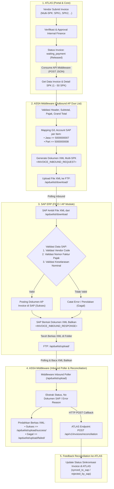
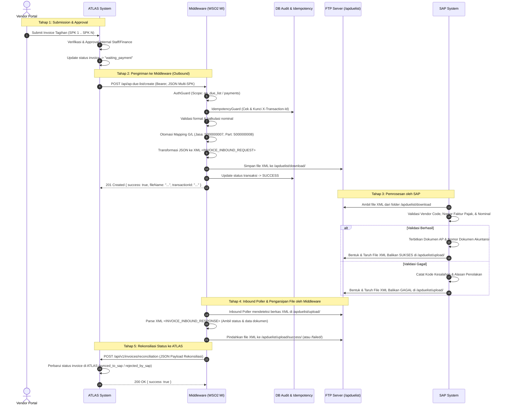

# Panduan Integrasi Developer — AP Due List (Multi-SPK Invoice XML over FTP)

> **Dokumen Resmi**: Arsitektur & Spesifikasi Integrasi AP Due List  
> **Status**: **Active / Current Standard**  
> **Menggantikan**: `spk-service` / `SPK Due List` (Dihilangkan) & `payments-service` / `Payment Due List` (Ditransformasi)  
> **Aktor Terlibat**: **ATLAS** (Portal & Backoffice), **ASSA Middleware (WSO2 MI)**, **SAP (FICO / Inbound AP)**  
> **Format Data**: JSON (Inbound ATLAS → Middleware), XML `<INVOICE_INBOUND_REQUEST>` (Outbound Middleware → SAP via FTP), dan XML `<INVOICE_INBOUND_RESPONSE>` (Inbound Balikan SAP di Folder `/apduelist/upload`)

---

## 1. Ringkasan Eksekutif & Perubahan Arsitektur

Berdasarkan standarisasi proses bisnis *Account Payable* (AP) untuk tagihan vendor servis armada di lingkungan PT Adi Sarana Armada Tbk (ASSA), dilakukan restrukturisasi alur integrasi sebagai berikut:

### 1.1. Perubahan Utama (Architectural Shifts)

1. **SPK Due List (`spk-service`) Dihilangkan**:
   - Pengiriman dokumen SPK satuan secara terpisah ke SAP (`/api/spk/duelist`) resmi **dihilangkan / di-deprecate**.
   - Dokumen SPK tidak lagi dikirimkan per satuan transaksi ke SAP, melainkan dikonsolidasikan langsung di bawah nomor penagihan (**Vendor Invoice / Billing**).
2. **Payment Due List Diganti Menjadi AP Due List**:
   - Layanan `Payment Due List` ditransformasikan menjadi **AP Due List** (*Accounts Payable Due List*).
   - AP Due List mengakomodasi struktur **Multi-SPK per Invoice** (1 lembar Invoice Vendor dapat menaungi **1 hingga 50 SPK**).
3. **Standarisasi G/L Account SAP Otomatis**:
   - Middleware bertanggung jawab memetakan komponen pekerjaan pada setiap SPK secara otomatis ke akun G/L SAP:
     - **Komponen Jasa** $\rightarrow$ **`5000000007`** (Biaya Jasa Perbaikan & Pemeliharaan)
     - **Komponen Part** $\rightarrow$ **`5000000008`** (Biaya Penggantian Sparepart / Bahan)
4. **Penyimpanan Berkas FTP Outbound**:
   - Berkas XML hasil generate (`INVOICE_INBOUND_REQUEST`) disimpan pada server FTP SAP di dalam direktori `/apduelist/download/`.
5. **Feedback Reconciliation Dua Arah via Folder FTP `/apduelist/upload/`**:
   - SAP **tidak memanggil HTTP secara langsung**, melainkan membentuk **berkas XML balikan** (berisi data status **berhasil atau gagal**) dan menaruhnya di folder FTP **/apduelist/upload/**.
   - Middleware memantau (*polling*) folder `/apduelist/upload/`, membaca berkas XML balikan SAP, mengarsipkan berkas ke subfolder `/success` atau `/failed`, lalu mengeksekusi HTTP Callback ke ATLAS (`POST /api/v1/invoices/reconciliation`) untuk memperbarui status sinkronisasi *invoice*.

---

## 2. Alur Proses Bisnis End-to-End

Berikut adalah visualisasi alur integrasi end-to-end dari penagihan vendor hingga rekonsiliasi status tagihan:

### 2.1. Flowchart Proses



### 2.2. Diagram Sequence Interaksi Sistem



---

## 3. Spesifikasi Kontrak API Inbound (ATLAS $\rightarrow$ Middleware)

### 3.1. Parameter Endpoint

| Atribut | Keterangan |
|---|---|
| **Path** | `POST /api/ap-due-list/create` |
| **Header Wajib** | `Authorization: Bearer <TOKEN>`<br/>`Content-Type: application/json`<br/>`X-Transaction-Id: <UUID / Idempotency Key>`<br/>`X-Correlation-Id: <Tracking ID>` |
| **Scope Akses** | `ap_due_list` (atau `payments`) |
| **Karakteristik** | Idempotent (request berulang dengan `X-Transaction-Id` sama akan mengembalikan replay data tanpa duplikasi unggahan) |

### 3.2. Spesifikasi Schema JSON Body

Payload request berupa objek JSON yang memuat elemen `header` dan array `spk_list`:

```typescript
interface ApDueListRequest {
  header: {
    billing_number: string;        // Nomor billing resmi di ATLAS (contoh: "BIL/0001/ASL/2026")
    invoice_number: string;        // Nomor invoice fisik/asli dari vendor (contoh: "INV-VENDOR-2026-001")
    invoice_date: string;          // Tanggal invoice (format YYYY-MM-DD)
    invoice_type: "spk";           // Tipe penagihan, bernilai "spk"
    memo?: string;                 // Catatan/keterangan penagihan
    vendor_code: string;           // Kode vendor terdaftar di SAP (contoh: "VEND-00192")
    vendor_name: string;           // Nama legal vendor
    company_code: string;          // Kode perusahaan ASSA (default: "1000")
    tenant_id: string;             // UUID Tenant ATLAS
    tax_invoice_number: string;    // Nomor Seri Faktur Pajak (NSFP) (contoh: "010.000-26.00000001")
    tax_invoice_date: string;      // Tanggal Faktur Pajak (format YYYY-MM-DD)
    currency: "IDR";               // Mata uang, default "IDR"
    total_subtotal_amount: number; // Total DPP seluruh SPK (tanpa desimal/integer)
    total_tax_amount: number;      // Total PPN seluruh SPK
    total_invoice_amount: number;  // Grand total keseluruhan invoice (Subtotal + Tax)
  };
  spk_list: Array<{
    spk_number: string;            // Nomor Surat Perintah Kerja (contoh: "SPK20260630-01")
    sr_number: string;             // Nomor Service Request (contoh: "SR-202606-00012")
    license_plate: string;         // Nomor Polisi armada (contoh: "B 1234 ABC")
    category: string;              // Kategori perawatan (contoh: "maintenance")
    sub_category: string;          // Sub kategori (contoh: "pb", "adhoc")
    spk_subtotal: number;          // Subtotal DPP khusus SPK ini
    spk_tax_amount: number;        // PPN khusus SPK ini
    spk_grand_total: number;       // Grand total SPK ini (spk_subtotal + spk_tax_amount)
    items: Array<{
      item_no: number;             // Baris urutan item (1, 2, ..)
      component: "jasa" | "part";  // Komponen item: menentukan G/L Account SAP
      gl_number?: string;          // Opsional: jika kosong, middleware memetakan otomatis
      item_name: string;           // Deskripsi pekerjaan / nama barang
      method: string;              // Metode pengerjaan (contoh: "repair", "ganti")
      qty: number;                 // Kuantitas pengerjaan/barang
      uom: string;                 // Satuan ukur (contoh: "UNT", "PC", "SET")
      unit_price: number;          // Harga satuan
      total_amount: number;        // Total harga item (qty * unit_price)
    }>;
  }>;
}
```

### 3.3. Contoh Payload JSON Request dari ATLAS

```json
{
  "header": {
    "billing_number": "BIL/0001/ASL/2026",
    "invoice_number": "INV-VENDOR-2026-001",
    "invoice_date": "2026-06-30",
    "invoice_type": "spk",
    "memo": "Tagihan Servis Armada Periode Juni 2026",
    "vendor_code": "VEND-00192",
    "vendor_name": "PT. Sumber Berkat Abadi",
    "company_code": "1000",
    "tenant_id": "d9804e7c-8647-495d-b0ad-54378f8cb6ee",
    "tax_invoice_number": "010.000-26.00000001",
    "tax_invoice_date": "2026-06-30",
    "currency": "IDR",
    "total_subtotal_amount": 2500000,
    "total_tax_amount": 275000,
    "total_invoice_amount": 2775000
  },
  "spk_list": [
    {
      "spk_number": "SPK20260630-01",
      "sr_number": "SR-202606-00012",
      "license_plate": "B 1234 ABC",
      "category": "maintenance",
      "sub_category": "pb",
      "spk_subtotal": 1200000,
      "spk_tax_amount": 132000,
      "spk_grand_total": 1332000,
      "items": [
        {
          "item_no": 1,
          "component": "jasa",
          "item_name": "Jasa Tune Up & Ganti Filter",
          "method": "repair",
          "qty": 1,
          "uom": "UNT",
          "unit_price": 200000,
          "total_amount": 200000
        },
        {
          "item_no": 2,
          "component": "part",
          "item_name": "Oli Mesin Synthetic 4L",
          "method": "ganti",
          "qty": 1,
          "uom": "PC",
          "unit_price": 1000000,
          "total_amount": 1000000
        }
      ]
    },
    {
      "spk_number": "SPK20260630-02",
      "sr_number": "SR-202606-00015",
      "license_plate": "B 5678 XYZ",
      "category": "maintenance",
      "sub_category": "adhoc",
      "spk_subtotal": 1300000,
      "spk_tax_amount": 143000,
      "spk_grand_total": 1443000,
      "items": [
        {
          "item_no": 1,
          "component": "jasa",
          "item_name": "Jasa Perbaikan Rem Depan",
          "method": "repair",
          "qty": 1,
          "uom": "UNT",
          "unit_price": 300000,
          "total_amount": 300000
        },
        {
          "item_no": 2,
          "component": "part",
          "item_name": "Brake Pad Set Depan",
          "method": "ganti",
          "qty": 1,
          "uom": "SET",
          "unit_price": 1000000,
          "total_amount": 1000000
        }
      ]
    }
  ]
}
```

---

## 4. Aturan Validasi Bisnis & Otomasi Pemetaan G/L Account

Sebelum file XML dibentuk dan diunggah ke FTP SAP, Middleware WSO2 MI menjalankan validasi bisnis yang ketat:

### 4.1. Tabel Validasi Data

| Parameter | Aturan Validasi | Kegagalan (HTTP 400) |
|---|---|---|
| **Jumlah SPK** | `spk_list` harus array berisi **minimal 1** dan **maksimal 50 SPK** | `spk_list must contain between 1 and 50 SPKs` |
| **Korelasi Subtotal** | $\sum (\text{spk\_subtotal}) = \text{total\_subtotal\_amount}$ | `total_subtotal_amount does not match sum of SPK subtotals` |
| **Korelasi Pajak (PPN)** | $\sum (\text{spk\_tax\_amount}) = \text{total\_tax\_amount}$ | `total_tax_amount does not match sum of SPK tax amounts` |
| **Korelasi Grand Total** | $\text{total\_subtotal\_amount} + \text{total\_tax\_amount} = \text{total\_invoice\_amount}$ | `total_invoice_amount does not match subtotal + tax amount` |
| **Item SPK** | Setiap SPK wajib memiliki minimal 1 item; $\sum (\text{total\_amount}) = \text{spk\_subtotal}$ | `SPK subtotal does not match sum of item amounts` |
| **Kalkulasi Item** | $\text{qty} \times \text{unit\_price} = \text{total\_amount}$ | `Item total_amount must equal qty * unit_price` |
| **Format Tanggal** | Wajib format `YYYY-MM-DD` | `Invalid date format, expected YYYY-MM-DD` |
| **Format Faktur Pajak** | Format standar NSFP 16 digit: `XXX.XXX-XX.XXXXXXXX` | `Invalid tax_invoice_number format` |

### 4.2. Aturan Pemetaan G/L Account SAP

Middleware secara otomatis melakukan mapping `GL_NUMBER` pada setiap line item berdasarkan nilai `component`:

| Nilai Komponen (`COMPONENT`) | Nomor Akun G/L SAP (`GL_NUMBER`) | Deskripsi Akun Akuntansi |
|---|---|---|
| `jasa` (case-insensitive) | **`5000000007`** | Beban Jasa Perbaikan & Pemeliharaan Armada |
| `part` (case-insensitive) | **`5000000008`** | Beban Spareparts & Bahan Perbaikan Armada |

> [!NOTE]
> Jika sistem asal (ATLAS) mengirimkan `gl_number` yang berbeda, Middleware akan menimpa (*override*) atau memverifikasi keselarasan sesuai aturan master G/L di atas untuk menjamin konsistensi jurnal di SAP.

---

## 5. Struktur Dokumen XML Target Outbound (`INVOICE_INBOUND_REQUEST`)

Dokumen XML yang digenerate oleh Middleware untuk konsumsi SAP mengikuti format resmi di bawah ini:

### 5.1. File XML Template

```xml
<?xml version="1.0" encoding="UTF-8"?>
<INVOICE_INBOUND_REQUEST>
  <!-- ======================================================== -->
  <!-- HEADER INVOICE VENDOR                                   -->
  <!-- ======================================================== -->
  <HEADER>
    <!-- Identitas Billing Atlas & Invoice Asli Vendor -->
    <BILLING_NUMBER>BIL/0001/ASL/2026</BILLING_NUMBER>
    <INVOICE_NUMBER>INV-VENDOR-2026-001</INVOICE_NUMBER>
    <INVOICE_DATE>2026-06-30</INVOICE_DATE>
    <INVOICE_TYPE>spk</INVOICE_TYPE>
    <MEMO>Tagihan Servis Armada Periode Juni 2026</MEMO>

    <!-- Data Vendor & Kompeni -->
    <VENDOR_CODE>VEND-00192</VENDOR_CODE>
    <VENDOR_NAME>PT. Sumber Berkat Abadi</VENDOR_NAME>
    <COMPANY_CODE>1000</COMPANY_CODE> <!-- Company Code ASSA -->
    <TENANT_ID>d9804e7c-8647-495d-b0ad-54378f8cb6ee</TENANT_ID>

    <!-- Pajak (Faktur Pajak) -->
    <TAX_INVOICE_NUMBER>010.000-26.00000001</TAX_INVOICE_NUMBER>
    <TAX_INVOICE_DATE>2026-06-30</TAX_INVOICE_DATE>

    <!-- Total Tagihan Keseluruhan Invoice (Seluruh SPK) -->
    <CURRENCY>IDR</CURRENCY>
    <TOTAL_SUBTOTAL_AMOUNT>2500000</TOTAL_SUBTOTAL_AMOUNT>
    <TOTAL_TAX_AMOUNT>275000</TOTAL_TAX_AMOUNT>
    <TOTAL_INVOICE_AMOUNT>2775000</TOTAL_INVOICE_AMOUNT>
  </HEADER>

  <!-- ======================================================== -->
  <!-- DAFTAR SPK (Bisa 1 s/d 50 SPK per Vendor Invoice)       -->
  <!-- ======================================================== -->
  <SPK_LIST>

    <!-- ==================== SPK PERTAMA ==================== -->
    <SPK>
      <SPK_NUMBER>SPK20260630-01</SPK_NUMBER>
      <SR_NUMBER>SR-202606-00012</SR_NUMBER>
      <LICENSE_PLATE>B 1234 ABC</LICENSE_PLATE>
      <CATEGORY>maintenance</CATEGORY>
      <SUB_CATEGORY>pb</SUB_CATEGORY>
      <SPK_SUBTOTAL>1200000</SPK_SUBTOTAL>
      <SPK_TAX_AMOUNT>132000</SPK_TAX_AMOUNT>
      <SPK_GRAND_TOTAL>1332000</SPK_GRAND_TOTAL>

      <ITEMS>
        <!-- Item SPK 1: Jasa -> G/L 5000000007 -->
        <ITEM>
          <ITEM_NO>1</ITEM_NO>
          <COMPONENT>jasa</COMPONENT>
          <GL_NUMBER>5000000007</GL_NUMBER>
          <ITEM_NAME>Jasa Tune Up & Ganti Filter</ITEM_NAME>
          <METHOD>repair</METHOD>
          <QTY>1</QTY>
          <UOM>UNT</UOM>
          <UNIT_PRICE>200000</UNIT_PRICE>
          <TOTAL_AMOUNT>200000</TOTAL_AMOUNT>
        </ITEM>

        <!-- Item SPK 1: Part -> G/L 5000000008 -->
        <ITEM>
          <ITEM_NO>2</ITEM_NO>
          <COMPONENT>part</COMPONENT>
          <GL_NUMBER>5000000008</GL_NUMBER>
          <ITEM_NAME>Oli Mesin Synthetic 4L</ITEM_NAME>
          <METHOD>ganti</METHOD>
          <QTY>1</QTY>
          <UOM>PC</UOM>
          <UNIT_PRICE>1000000</UNIT_PRICE>
          <TOTAL_AMOUNT>1000000</TOTAL_AMOUNT>
        </ITEM>
      </ITEMS>
    </SPK>

    <!-- ==================== SPK KEDUA ==================== -->
    <SPK>
      <SPK_NUMBER>SPK20260630-02</SPK_NUMBER>
      <SR_NUMBER>SR-202606-00015</SR_NUMBER>
      <LICENSE_PLATE>B 5678 XYZ</LICENSE_PLATE>
      <CATEGORY>maintenance</CATEGORY>
      <SUB_CATEGORY>adhoc</SUB_CATEGORY>
      <SPK_SUBTOTAL>1300000</SPK_SUBTOTAL>
      <SPK_TAX_AMOUNT>143000</SPK_TAX_AMOUNT>
      <SPK_GRAND_TOTAL>1443000</SPK_GRAND_TOTAL>

      <ITEMS>
        <!-- Item SPK 2: Jasa -> G/L 5000000007 -->
        <ITEM>
          <ITEM_NO>1</ITEM_NO>
          <COMPONENT>jasa</COMPONENT>
          <GL_NUMBER>5000000007</GL_NUMBER>
          <ITEM_NAME>Jasa Perbaikan Rem Depan</ITEM_NAME>
          <METHOD>repair</METHOD>
          <QTY>1</QTY>
          <UOM>UNT</UOM>
          <UNIT_PRICE>300000</UNIT_PRICE>
          <TOTAL_AMOUNT>300000</TOTAL_AMOUNT>
        </ITEM>

        <!-- Item SPK 2: Part -> G/L 5000000008 -->
        <ITEM>
          <ITEM_NO>2</ITEM_NO>
          <COMPONENT>part</COMPONENT>
          <GL_NUMBER>5000000008</GL_NUMBER>
          <ITEM_NAME>Brake Pad Set Depan</ITEM_NAME>
          <METHOD>ganti</METHOD>
          <QTY>1</QTY>
          <UOM>SET</UOM>
          <UNIT_PRICE>1000000</UNIT_PRICE>
          <TOTAL_AMOUNT>1000000</TOTAL_AMOUNT>
        </ITEM>
      </ITEMS>
    </SPK>

  </SPK_LIST>
</INVOICE_INBOUND_REQUEST>
```

### 5.2. Kamus Data Tag XML Request

#### Tag `<HEADER>`

| Tag XML | Tipe Data | Keterangan |
|---|---|---|
| `<BILLING_NUMBER>` | String(50) | Nomor billing unik internal ATLAS |
| `<INVOICE_NUMBER>` | String(50) | Nomor invoice resmi yang dicetak oleh vendor |
| `<INVOICE_DATE>` | Date (`YYYY-MM-DD`) | Tanggal penerbitan invoice vendor |
| `<INVOICE_TYPE>` | String | Tipe tagihan, diisi `spk` |
| `<MEMO>` | String(255) | Keterangan bebas ringkasan invoice |
| `<VENDOR_CODE>` | String(20) | Kode akun vendor yang terdaftar di SAP |
| `<VENDOR_NAME>` | String(100) | Nama legal vendor sesuai SAP |
| `<COMPANY_CODE>` | String(4) | Kode entitas ASSA (contoh: `1000`) |
| `<TENANT_ID>` | String(36) | Identifier tenant / sistem pengirim |
| `<TAX_INVOICE_NUMBER>` | String(30) | Nomor Seri Faktur Pajak resmi dari DJP |
| `<TAX_INVOICE_DATE>` | Date (`YYYY-MM-DD`) | Tanggal pelaporan faktur pajak |
| `<CURRENCY>` | String(3) | Kode mata uang transaksi (`IDR`) |
| `<TOTAL_SUBTOTAL_AMOUNT>` | Long / Numeric | Akumulasi nilai DPP seluruh SPK |
| `<TOTAL_TAX_AMOUNT>` | Long / Numeric | Akumulasi nilai PPN seluruh SPK |
| `<TOTAL_INVOICE_AMOUNT>` | Long / Numeric | Total tagihan kotor invoice (DPP + PPN) |

#### Tag `<SPK_LIST>` $\rightarrow$ `<SPK>`

| Tag XML | Tipe Data | Keterangan |
|---|---|---|
| `<SPK_NUMBER>` | String(50) | Nomor referensi Surat Perintah Kerja |
| `<SR_NUMBER>` | String(50) | Nomor tiket Service Request yang mendasari SPK |
| `<LICENSE_PLATE>` | String(15) | Nomor polisi kendaraan yang diperbaiki |
| `<CATEGORY>` | String(30) | Kategori pekerjaan (e.g. `maintenance`) |
| `<SUB_CATEGORY>` | String(30) | Sub-kategori pekerjaan (e.g. `pb`, `adhoc`) |
| `<SPK_SUBTOTAL>` | Long / Numeric | DPP rincian item dalam SPK bersangkutan |
| `<SPK_TAX_AMOUNT>` | Long / Numeric | PPN yang dikenakan pada SPK bersangkutan |
| `<SPK_GRAND_TOTAL>` | Long / Numeric | Total akhir nilai SPK |

#### Tag `<ITEMS>` $\rightarrow$ `<ITEM>`

| Tag XML | Tipe Data | Keterangan |
|---|---|---|
| `<ITEM_NO>` | Integer | Urutan item dalam SPK (1, 2, ..) |
| `<COMPONENT>` | String | Jenis komponen: `jasa` atau `part` |
| `<GL_NUMBER>` | String(10) | Akun G/L SAP (`5000000007` / `5000000008`) |
| `<ITEM_NAME>` | String(150) | Deskripsi rinci jasa atau sparepart |
| `<METHOD>` | String(30) | Metode penanganan (repair, ganti, check, dll) |
| `<QTY>` | Integer / Double | Jumlah kuantitas |
| `<UOM>` | String(10) | Satuan unit (UNT, PC, SET, LTR, dll) |
| `<UNIT_PRICE>` | Long / Numeric | Harga satuan pekerjaan/barang |
| `<TOTAL_AMOUNT>` | Long / Numeric | Total harga baris item |

---

## 6. Spesifikasi File Interface & Direktori FTP

Integrasi antara Middleware dan SAP sepenuhnya berbasis pertukaran file XML pada server FTP SAP:

### 6.1. Struktur Hirarki Direktori FTP

Struktur folder remote pada server FTP SAP untuk domain AP Due List:

```text
/apduelist/
├── download/               <-- Outbound: Middleware menaruh XML <INVOICE_INBOUND_REQUEST> untuk diambil SAP
└── upload/                 <-- Inbound: SAP menaruh XML <INVOICE_INBOUND_RESPONSE> hasil proses (sukses/gagal)
    ├── success/            <-- Arsip: Middleware memindahkan file balikan yang telah sukses di-callback ke ATLAS
    └── failed/             <-- Arsip: File balikan yang gagal diproses/callback (target reprocess worker)
```

| Path Direktori | Penulis (Writer) | Pembaca (Reader) | Keterangan |
|---|---|---|---|
| `/apduelist/download` | **Middleware** | **SAP** | Berkas XML tagihan multi-SPK siap proses oleh SAP |
| `/apduelist/upload` | **SAP** | **Middleware** | Berkas XML balikan status eksekusi (**berhasil** atau **gagal**) |
| `/apduelist/upload/success` | **Middleware** | — | Berkas arsip setelah callback status ke ATLAS berstatus 200 OK |
| `/apduelist/upload/failed` | **Middleware** | **Worker** | Berkas arsip jika callback ke ATLAS timeout / error |

### 6.2. Pola Penamaan Berkas XML

#### A. Penamaan File Request dari Middleware (`/apduelist/download/`)
```text
INV-<INVOICE_NUMBER>-<YYYYMMDDHHMMSS>.xml
```
*Contoh*: `INV-INV-VENDOR-2026-01-20261021144555.xml`

#### B. Penamaan File Response dari SAP (`/apduelist/upload/`)
```text
RESP_AP_<STATUS>_<COMPANY_CODE>_<CLEAN_BILLING_NUMBER>_<YYYYMMDDHHmmss>.xml
```
*Contoh Berhasil*: `RESP_AP_SUCCESS_1000_BIL-0001-ASL-2026_20260630151022.xml`  
*Contoh Gagal*: `RESP_AP_FAILED_1000_BIL-0001-ASL-2026_20260630151025.xml`

---

## 7. Mekanisme Validasi & Pemrosesan di Sisi SAP

Ketika program *background job* SAP membaca berkas XML dari `/apduelist/download`, SAP akan melakukan validasi berurutan:

1. **Validasi Vendor (`VENDOR_CODE`)**:
   - Memastikan kode vendor terdaftar di Master Data Vendor SAP (`LFA1`/`LFB1`) untuk `COMPANY_CODE` yang bersangkutan.
   - Memastikan status vendor aktif (tidak dalam masa blokir tagihan).
2. **Validasi Nomor Faktur Pajak (`TAX_INVOICE_NUMBER`)**:
   - Memastikan nomor seri faktur pajak belum pernah dibukukan sebelumnya di SAP (mencegah klaim faktur pajak ganda).
   - Memastikan tanggal faktur pajak masih berada dalam periode pembukuan terbuka.
3. **Validasi Nominal & Toleransi**:
   - Memverifikasi apakah total subtotal, pajak, dan grand total di Header sama persis dengan total matematis akumulasi item dan SPK.
   - Jika terdapat selisih pembulatan, dokumen ditolak.
4. **Pembentukan Berkas Balikan di Folder `/apduelist/upload/`**:
   - Setelah selesai diproses, **SAP wajib membuat 1 berkas XML balikan** di folder `/apduelist/upload/` baik untuk kondisi sukses maupun kondisi gagal.

---

## 8. Feedback Reconciliation ke ATLAS

Bagian ini menjelaskan secara rinci mekanisme rekonsiliasi data hasil proses SAP kembali ke ATLAS.

### 8.1. Format XML Balikan yang Dibuat SAP di Folder `/apduelist/upload/`

SAP membuat berkas XML dengan root tag `<INVOICE_INBOUND_RESPONSE>` pada folder `/apduelist/upload/`:

#### A. Format XML Balikan Kasus SUKSES (Posted di SAP)

```xml
<?xml version="1.0" encoding="UTF-8"?>
<INVOICE_INBOUND_RESPONSE>
  <HEADER>
    <!-- Referensi Billing & Invoice Pengirim -->
    <BILLING_NUMBER>BIL/0001/ASL/2026</BILLING_NUMBER>
    <INVOICE_NUMBER>INV-VENDOR-2026-001</INVOICE_NUMBER>
    <COMPANY_CODE>1000</COMPANY_CODE>

    <!-- Hasil Pemrosesan SAP -->
    <STATUS>SUCCESS</STATUS>
    <SAP_DOCUMENT_NUMBER>1900001234</SAP_DOCUMENT_NUMBER>
    <FISCAL_YEAR>2026</FISCAL_YEAR>
    <CURRENCY>IDR</CURRENCY>
    <TOTAL_INVOICE_AMOUNT>2775000</TOTAL_INVOICE_AMOUNT>
    <POSTED_DATE>2026-06-30</POSTED_DATE>
    <PROCESSED_TIMESTAMP>2026-06-30 15:10:22</PROCESSED_TIMESTAMP>
    <MESSAGE>Dokumen AP Invoice berhasil dibukukan di SAP</MESSAGE>
  </HEADER>

  <SPK_RESULTS>
    <SPK>
      <SPK_NUMBER>SPK20260630-01</SPK_NUMBER>
      <STATUS>POSTED</STATUS>
    </SPK>
    <SPK>
      <SPK_NUMBER>SPK20260630-02</SPK_NUMBER>
      <STATUS>POSTED</STATUS>
    </SPK>
  </SPK_RESULTS>
</INVOICE_INBOUND_RESPONSE>
```

#### B. Format XML Balikan Kasus GAGAL (Rejected di SAP)

```xml
<?xml version="1.0" encoding="UTF-8"?>
<INVOICE_INBOUND_RESPONSE>
  <HEADER>
    <!-- Referensi Billing & Invoice Pengirim -->
    <BILLING_NUMBER>BIL/0001/ASL/2026</BILLING_NUMBER>
    <INVOICE_NUMBER>INV-VENDOR-2026-001</INVOICE_NUMBER>
    <COMPANY_CODE>1000</COMPANY_CODE>

    <!-- Hasil Pemrosesan Gagal di SAP -->
    <STATUS>FAILED</STATUS>
    <SAP_DOCUMENT_NUMBER/>
    <FISCAL_YEAR>2026</FISCAL_YEAR>
    <ERROR_CODE>SAP_TAX_INVOICE_DUPLICATE</ERROR_CODE>
    <ERROR_MESSAGE>Nomor Faktur Pajak 010.000-26.00000001 sudah pernah digunakan pada dokumen SAP 1900000881</ERROR_MESSAGE>
    <PROCESSED_TIMESTAMP>2026-06-30 15:10:25</PROCESSED_TIMESTAMP>
  </HEADER>

  <SPK_RESULTS>
    <SPK>
      <SPK_NUMBER>SPK20260630-01</SPK_NUMBER>
      <STATUS>REJECTED</STATUS>
      <REASON>Nomor Faktur Pajak Duplikat</REASON>
    </SPK>
    <SPK>
      <SPK_NUMBER>SPK20260630-02</SPK_NUMBER>
      <STATUS>REJECTED</STATUS>
      <REASON>Nomor Faktur Pajak Duplikat</REASON>
    </SPK>
  </SPK_RESULTS>
</INVOICE_INBOUND_RESPONSE>
```

### 8.2. Kamus Data Tag XML Balikan SAP (`INVOICE_INBOUND_RESPONSE`)

| Tag XML | Tipe Data | Wajib? | Keterangan |
|---|---|---|---|
| `<BILLING_NUMBER>` | String | Ya | Nomor billing ATLAS asal transaksi |
| `<INVOICE_NUMBER>` | String | Ya | Nomor invoice vendor asal |
| `<COMPANY_CODE>` | String(4) | Ya | Kode perusahaan ASSA (e.g. `1000`) |
| `<STATUS>` | String | Ya | Status eksekusi SAP: `SUCCESS` atau `FAILED` |
| `<SAP_DOCUMENT_NUMBER>` | String(10) | Ya (jika SUCCESS) | Nomor dokumen akuntansi AP yang diterbitkan SAP |
| `<FISCAL_YEAR>` | String(4) | Ya | Tahun fiskal pembukuan SAP (contoh: `2026`) |
| `<POSTED_DATE>` | Date | Kondisional | Tanggal pembukuan jurnal di SAP (`YYYY-MM-DD`) |
| `<ERROR_CODE>` | String(50) | Ya (jika FAILED) | Kode error standar SAP |
| `<ERROR_MESSAGE>` | String(255) | Ya (jika FAILED) | Deskripsi rinci penyebab dokumen ditolak |
| `<PROCESSED_TIMESTAMP>` | DateTime | Ya | Waktu selesai proses di SAP (`YYYY-MM-DD HH:mm:ss`) |
| `<MESSAGE>` | String(255) | Tidak | Pesan keterangan tambahan dari SAP |

---

### 8.3. Alur Poller & Pengarsipan Berkas oleh Middleware

Middleware mengoperasikan listener VFS / Inbound Poller yang secara otomatis mendeteksi file di `/apduelist/upload/`:

1. **Deteksi Berkas**:
   - Poller membaca berkas XML yang ada di folder `/apduelist/upload/`.
2. **Idempotency Guard Rekonsiliasi**:
   - Middleware memeriksa apakah kombinasi `BILLING_NUMBER` + `PROCESSED_TIMESTAMP` sudah pernah sukses dikirim ke ATLAS untuk mencegah duplikasi update status.
3. **Pengarsipan Otomatis Berkas FTP**:
   - Jika proses parsing dan pemanggilan callback ke ATLAS berhasil: berkas dipindahkan ke `/apduelist/upload/success/`.
   - Jika terjadi kendala koneksi atau kegagalan callback ke ATLAS: berkas dipindahkan ke `/apduelist/upload/failed/` agar diproses ulang oleh worker reprocess.

---

### 8.4. Kontrak HTTP Callback Rekonsiliasi (Middleware $\rightarrow$ ATLAS)

Setelah membaca XML dari `/apduelist/upload/`, Middleware mentransformasikan data tersebut menjadi payload JSON dan memanggil API rekonsiliasi internal ATLAS:

```http
POST /api/v1/invoices/reconciliation
Host: {atlas-core-host}
Authorization: Bearer <INTERNAL_APP_TOKEN>
Content-Type: application/json
X-Correlation-Id: <UUID>
```

#### A. Payload Callback Sukses (Posted di SAP)
```json
{
  "billing_number": "BIL/0001/ASL/2026",
  "invoice_number": "INV-VENDOR-2026-001",
  "company_code": "1000",
  "status": "SUCCESS",
  "sap_document_number": "1900001234",
  "fiscal_year": "2026",
  "currency": "IDR",
  "total_invoice_amount": 2775000,
  "posted_date": "2026-06-30",
  "processed_at": "2026-06-30 15:10:22",
  "message": "Dokumen AP Invoice berhasil dibukukan di SAP",
  "spk_results": [
    {
      "spk_number": "SPK20260630-01",
      "status": "POSTED"
    },
    {
      "spk_number": "SPK20260630-02",
      "status": "POSTED"
    }
  ]
}
```

#### B. Payload Callback Gagal (Ditolak oleh SAP)
```json
{
  "billing_number": "BIL/0001/ASL/2026",
  "invoice_number": "INV-VENDOR-2026-001",
  "company_code": "1000",
  "status": "FAILED",
  "error_code": "SAP_TAX_INVOICE_DUPLICATE",
  "error_message": "Nomor Faktur Pajak 010.000-26.00000001 sudah pernah digunakan pada dokumen SAP 1900000881",
  "processed_at": "2026-06-30 15:10:25",
  "spk_results": [
    {
      "spk_number": "SPK20260630-01",
      "status": "REJECTED",
      "reason": "Nomor Faktur Pajak Duplikat"
    },
    {
      "spk_number": "SPK20260630-02",
      "status": "REJECTED",
      "reason": "Nomor Faktur Pajak Duplikat"
    }
  ]
}
```

#### C. Respons yang Diharapkan dari ATLAS
```json
{
  "success": true,
  "billing_number": "BIL/0001/ASL/2026",
  "invoice_status": "synced_to_sap",
  "message": "Invoice reconciliation status updated successfully"
}
```

---

## 9. Penanganan Error & Respon HTTP (Middleware Outbound)

| HTTP Status | Kondisi | Format Respon JSON |
|---|---|---|
| **201 Created** | Dokumen XML berhasil divalidasi dan diunggah ke FTP SAP | `{"success": true, "message": "AP Due List successfully generated and delivered to FTP", "billingNumber": "...", "fileName": "...", "transactionId": "..."}` |
| **200 OK (Replay)** | Request berulang dengan `X-Transaction-Id` sama dan status transaksi sudah `SUCCESS` | Mengembalikan riwayat respon transaksi sebelumnya tanpa mengunggah ulang file |
| **400 Bad Request** | Kesalahan validasi format, header kosong, atau ketidaksesuaian nominal matematika | `{"error": "Bad Request", "detail": "total_invoice_amount does not match subtotal + tax amount"}` |
| **401 Unauthorized** | Token otentikasi tidak disertakan atau kedaluwarsa | `{"error": "Unauthorized", "detail": "Invalid or expired Bearer token"}` |
| **403 Forbidden** | Client tidak memiliki izin scope `ap_due_list` atau `payments` | `{"error": "Forbidden", "detail": "Insufficient scope permissions"}` |
| **409 Conflict** | Transaksi dengan `X-Transaction-Id` sama sedang dalam status `PROCESSING` | `{"error": "Conflict", "detail": "Transaction is currently being processed"}` |
| **502 Bad Gateway** | Server FTP SAP tidak dapat dihubungi atau timeout | `{"error": "Bad Gateway", "detail": "Failed to connect to SAP FTP server"}` |

---