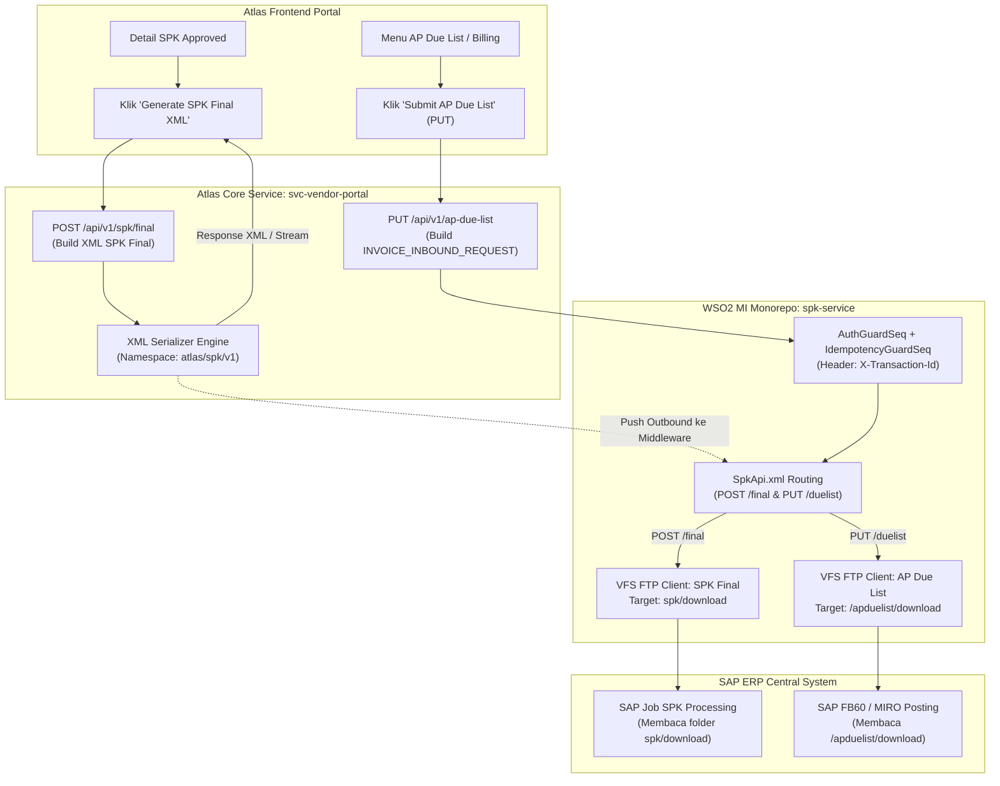

# Panduan Teknis Tim Developer: Endpoint SPK Final (POST — XML Generator) & Migrasi AP Due List (PUT — Inbound Invoice)

> **Dokumen Panduan Teknis & Arsitektur Integrasi**  
> **Target Audiens:** Frontend Developer (`assa-atlas-fe-vendor-portal`), Backend Developer (`assa-atlas-svc-vendor-portal`), Middleware & Integration Engineer (`wso2-mi-monorepo`), QA & Support Engineer.  
> **Tanggal Rilis:** 20 Oktober 2026  
> **Status:** APPROVED / READY FOR IMPLEMENTATION  

---

## 1. Ringkasan Eksekutif & Tujuan Perubahan

Dokumen ini disusun sebagai panduan standar bagi seluruh tim engineer terkait **2 (dua) perubahan arsitektur utama** pada modul SPK (Surat Perintah Kerja) dan Billing/Invoice di ekosistem **ASSA Atlas Platform** & **Middleware WSO2 MI**:

1. **Tambahan Endpoint Baru: `POST /api/v1/spk/final` (Generate Dokumen XML SPK Final)**  
   Menyediakan fungsi otomatis untuk membentuk (generate) dokumen XML SPK Final resmi ber-namespace `xmlns="http://assa.id/atlas/spk/v1"`. Generator ini wajib mendukung **4 skenario kombinasi bisnis**:
   - Skenario 1: Eksternal + Maintenance
   - Skenario 2: Internal + Maintenance
   - Skenario 3: Eksternal + Body Repair
   - Skenario 4: Internal + Body Repair
   
2. **Perubahan Arsitektur: Migrasi Endpoint AP Due List dari Method `POST` Menjadi `PUT`**  
   Pengiriman tagihan vendor berkas SPK (AP Due List Inbound ke SAP / Middleware) diubah dari HTTP Method `POST` menjadi `PUT` (`PUT /api/v1/ap-due-list` atau `PUT /api/spk/duelist`).  
   - **Rationale:** Mengikuti kaidah RESTful idempotency, di mana berkas billing/invoice vendor yang telah diterbitkan nomornya (`BILLING_NUMBER`) mengalami mutasi status menjadi *due list* atau dilakukan *resubmit / state replacement*. Hal ini mencegah risiko *double posting* dokumen akuntansi di SAP ERP.  
   - Format XML AP Due List menggunakan schema berakar `<INVOICE_INBOUND_REQUEST>`.

---

## 2. Arsitektur & Alur Kerja Integrasi End-to-End



---

## 3. BAGIAN 1: Endpoint Tambahan SPK Final (`POST`) — XML Generation

### 3.1 Spesifikasi Teknis Endpoint

| Parameter | Spesifikasi Teknis |
|---|---|
| **HTTP Method** | `POST` |
| **URL Endpoint (Atlas)** | `/api/v1/spk/final` |
| **URL Endpoint (Middleware)** | `/api/spk/final` |
| **Authorization** | `Bearer <JWT_TOKEN>` (Scope: `spk` / `vendor`) |
| **Target Folder FTP (SAP)** | `spk/download` (atau `/spk/download/` pada FTP Server SAP) |
| **Pola Penamaan Berkas** | `SPK_FINAL_<COMPANY>_<SPK_NUMBER>_<YYYYMMDDHHmmss>.xml` atau `SPK-{spk_number}.xml` |
| **Content-Type Request** | `application/json` (Berisi identitas SPK atau filter generate) |
| **Content-Type Response** | `application/xml; charset=UTF-8` |
| **Response Header** | `Content-Disposition: attachment; filename="SPK-{spk_number}.xml"` |

### 3.2 Matriks Aturan Bisnis & Variasi Tag XML

XML SPK Final dibungkus dalam root tag:
```xml
<SPK_DOCUMENT xmlns="http://assa.id/atlas/spk/v1">
...
</SPK_DOCUMENT>
```

| Bagian Elemen | Eksternal + Maintenance | Internal + Maintenance | Eksternal + Body Repair | Internal + Body Repair |
|---|---|---|---|---|
| `<HEADER>` -> `<SPK_TYPE>` | `EKSTERNAL` | `INTERNAL` | `EKSTERNAL` | `INTERNAL` |
| `<HEADER>` -> `<CATEGORY>` | `MAINTENANCE` | `MAINTENANCE` | `BODY_REPAIR` | `BODY_REPAIR` |
| `<HEADER>` -> `<SUB_CATEGORY>` | **Wajib Ada** (`PB` / `PBTT` / `ADHOC`) | **Wajib Ada** (`PB` / `PBTT` / `ADHOC`) | **DILARANG ADA** (Omit tag) | **DILARANG ADA** (Omit tag) |
| `<PARTY_INFO>` | Berisi tag vendor:<br>`<VENDOR_CODE>`<br>`<VENDOR_NAME>`<br>`<VENDOR_TAX_NUMBER>` | Berisi tag internal:<br>`<WORKSHOP_TYPE>`<br>`<PIC_SERVICE_CODE>`<br>`<PIC_SERVICE_NAME>` | Berisi tag vendor:<br>`<VENDOR_CODE>`<br>`<VENDOR_NAME>`<br>`<VENDOR_TAX_NUMBER>` | Berisi tag internal:<br>`<WORKSHOP_TYPE>`<br>`<PIC_SERVICE_CODE>`<br>`<PIC_SERVICE_NAME>` |
| `<CATEGORY_DETAIL>` | `<MAINTENANCE_DETAIL>`:<br>`<KM_SERVICE>` | `<MAINTENANCE_DETAIL>`:<br>`<KM_SERVICE>`<br>`<PIC_SERVICE>`<br>`<PIC_SERVICE_NAME>` | `<BODY_REPAIR_DETAIL>`:<br>`<ITEM_CODE>own_risk</ITEM_CODE>`<br>`<REPAIR_TYPE>`<br>`<TOTAL_COST_AMOUNT>`<br>`<CLAIM_NUMBER>`<br>`<INCIDENT_CHRONOLOGY>` | `<BODY_REPAIR_DETAIL>`:<br>`<ITEM_CODE>own_risk</ITEM_CODE>`<br>`<REPAIR_TYPE>`<br>`<TOTAL_COST_AMOUNT>`<br>`<PIC_SERVICE>`<br>`<PIC_SERVICE_NAME>`<br>`<INCIDENT_CHRONOLOGY>` |
| `<TAX_AND_TOTALS>` | `IS_PPN: true`<br>`PPN_RATE: 11.00`<br>`PPN_AMOUNT: nominal` | `IS_PPN: false`<br>`PPN_RATE: 0.00`<br>`PPN_AMOUNT: 0` | `IS_PPN: true`<br>`PPN_RATE: 11.00`<br>`PPN_AMOUNT: nominal` | `IS_PPN: false`<br>`PPN_RATE: 0.00`<br>`PPN_AMOUNT: 0` |
| `<LINE_ITEMS>` -> G/L Account | Jasa = `5000000007`<br>Part/Ban = `5000000008` | Jasa = `5000000007`<br>Part = `5000000008` | Jasa (Ketok/Cat) = `5000000007`<br>Part (Ganti) = `5000000008` | Jasa (Poles/Cat) = `5000000007`<br>Part (Compound) = `5000000008` |
| Tag Khusus Ban | Memiliki `<TIRE_METADATA>` jika tipe BAN | - | - | - |

---

### 3.3 Skenario 1: SPK Final — Eksternal + Maintenance

```xml
<?xml version="1.0" encoding="UTF-8"?>
<SPK_DOCUMENT xmlns="http://assa.id/atlas/spk/v1">
  <!-- Identitas Dokumen SPK Final -->
  <HEADER>
    <SPK_NUMBER>SPK20261020-01</SPK_NUMBER>
    <SR_NUMBER>SR20261019-0012</SR_NUMBER>
    <SPK_TYPE>EKSTERNAL</SPK_TYPE>
    <CATEGORY>MAINTENANCE</CATEGORY>
    <SUB_CATEGORY>PB</SUB_CATEGORY>
    <STATUS>APPROVED</STATUS>
    <IS_REWORK>false</IS_REWORK>
    <IS_BACK_CHARGE>false</IS_BACK_CHARGE>
    <LICENSE_PLATE>B 1234 ABC</LICENSE_PLATE>
    <BRANCH_CODE>1201</BRANCH_CODE>
    <BRANCH_NAME>Cabang Jakarta Barat</BRANCH_NAME>
    <COMPANY_CODE>1000</COMPANY_CODE>
    <START_SERVICE_AT>2026-10-20T08:30:00Z</START_SERVICE_AT>
    <END_SERVICE_AT>2026-10-20T14:00:00Z</END_SERVICE_AT>
  </HEADER>

  <!-- Pihak Rekanan Eksternal (Vendor) -->
  <PARTY_INFO>
    <VENDOR_CODE>VEND-00192</VENDOR_CODE>
    <VENDOR_NAME>PT. Sumber Jaya Motor</VENDOR_NAME>
    <VENDOR_TAX_NUMBER>01.234.567.8-012.000</VENDOR_TAX_NUMBER>
  </PARTY_INFO>

  <!-- Detail Kategori Maintenance -->
  <CATEGORY_DETAIL>
    <MAINTENANCE_DETAIL>
      <KM_SERVICE>45200</KM_SERVICE>
    </MAINTENANCE_DETAIL>
  </CATEGORY_DETAIL>

  <!-- Rincian Nilai Finansial dan Pajak -->
  <TAX_AND_TOTALS>
    <CURRENCY>IDR</CURRENCY>
    <IS_PPN>true</IS_PPN>
    <PPN_RATE>11.00</PPN_RATE>
    <SUBTOTAL>2350000</SUBTOTAL>
    <PPN_AMOUNT>258500</PPN_AMOUNT>
    <GRAND_TOTAL>2608500</GRAND_TOTAL>
  </TAX_AND_TOTALS>

  <!-- Daftar Item Pengerjaan (Jasa, Part, dan Ban) -->
  <LINE_ITEMS>
    <!-- Item 1: Jasa Tune Up & Filter -> G/L 5000000007 -->
    <ITEM>
      <ITEM_NO>1</ITEM_NO>
      <ITEM_GROUP>OH_ENGINE</ITEM_GROUP>
      <ITEM_TYPE>JASA</ITEM_TYPE>
      <COMPONENT>jasa</COMPONENT>
      <GL_NUMBER>5000000007</GL_NUMBER>
      <METHOD>REPAIR</METHOD>
      <DESCRIPTION>Jasa Tune Up &amp; Pembersihan Throttle Body</DESCRIPTION>
      <QTY>1</QTY>
      <UOM>UNT</UOM>
      <UNIT_PRICE>350000</UNIT_PRICE>
      <TOTAL_AMOUNT>350000</TOTAL_AMOUNT>
    </ITEM>

    <!-- Item 2: Part Oli Mesin Synthetic -> G/L 5000000008 -->
    <ITEM>
      <ITEM_NO>2</ITEM_NO>
      <ITEM_GROUP>OH_ENGINE</ITEM_GROUP>
      <ITEM_TYPE>PART</ITEM_TYPE>
      <COMPONENT>part</COMPONENT>
      <GL_NUMBER>5000000008</GL_NUMBER>
      <METHOD>GANTI</METHOD>
      <DESCRIPTION>Oli Mesin Fully Synthetic 5W-30 (Galon 4 Liter)</DESCRIPTION>
      <QTY>1</QTY>
      <UOM>PC</UOM>
      <UNIT_PRICE>650000</UNIT_PRICE>
      <TOTAL_AMOUNT>650000</TOTAL_AMOUNT>
    </ITEM>

    <!-- Item 3: Part Kampas Rem Depan -> G/L 5000000008 -->
    <ITEM>
      <ITEM_NO>3</ITEM_NO>
      <ITEM_GROUP>BRAKE</ITEM_GROUP>
      <ITEM_TYPE>PART</ITEM_TYPE>
      <COMPONENT>part</COMPONENT>
      <GL_NUMBER>5000000008</GL_NUMBER>
      <METHOD>GANTI</METHOD>
      <DESCRIPTION>Brake Pad Set Depan Original</DESCRIPTION>
      <QTY>1</QTY>
      <UOM>SET</UOM>
      <UNIT_PRICE>450000</UNIT_PRICE>
      <TOTAL_AMOUNT>450000</TOTAL_AMOUNT>
    </ITEM>

    <!-- Item 4: Ban Fisik Penggantian Depan Kanan -> G/L 5000000008 -->
    <ITEM>
      <ITEM_NO>4</ITEM_NO>
      <ITEM_GROUP>BAN</ITEM_GROUP>
      <ITEM_TYPE>BAN</ITEM_TYPE>
      <COMPONENT>part</COMPONENT>
      <GL_NUMBER>5000000008</GL_NUMBER>
      <METHOD>GANTI</METHOD>
      <DESCRIPTION>Ban Bridgestone Ecopia 185/65 R15 (Depan Kanan)</DESCRIPTION>
      <QTY>1</QTY>
      <UOM>PC</UOM>
      <UNIT_PRICE>900000</UNIT_PRICE>
      <TOTAL_AMOUNT>900000</TOTAL_AMOUNT>
      <TIRE_METADATA>
        <POSITION>DEPAN_KANAN</POSITION>
        <TIRE_TYPE>RADIAL</TIRE_TYPE>
        <BRAND>Bridgestone</BRAND>
        <SIZE>185/65 R15</SIZE>
        <TIRE_CODE>BR-1856515-EC</TIRE_CODE>
      </TIRE_METADATA>
    </ITEM>
  </LINE_ITEMS>
</SPK_DOCUMENT>
```

---

### 3.4 Skenario 2: SPK Final — Internal + Maintenance

```xml
<?xml version="1.0" encoding="UTF-8"?>
<SPK_DOCUMENT xmlns="http://assa.id/atlas/spk/v1">
  <HEADER>
    <SPK_NUMBER>SPK20261020-02</SPK_NUMBER>
    <SR_NUMBER>SR20261019-0015</SR_NUMBER>
    <SPK_TYPE>INTERNAL</SPK_TYPE>
    <CATEGORY>MAINTENANCE</CATEGORY>
    <SUB_CATEGORY>PBTT</SUB_CATEGORY>
    <STATUS>APPROVED</STATUS>
    <IS_REWORK>false</IS_REWORK>
    <IS_BACK_CHARGE>false</IS_BACK_CHARGE>
    <LICENSE_PLATE>B 5678 XYZ</LICENSE_PLATE>
    <BRANCH_CODE>1202</BRANCH_CODE>
    <BRANCH_NAME>Cabang Tangerang</BRANCH_NAME>
    <COMPANY_CODE>1000</COMPANY_CODE>
    <START_SERVICE_AT>2026-10-20T09:00:00Z</START_SERVICE_AT>
    <END_SERVICE_AT>2026-10-20T12:00:00Z</END_SERVICE_AT>
  </HEADER>

  <!-- Pihak Internal (PIC Workshop Pool) - Tanpa Tag Vendor -->
  <PARTY_INFO>
    <WORKSHOP_TYPE>INTERNAL_POOL</WORKSHOP_TYPE>
    <PIC_SERVICE_CODE>TS_POOL</PIC_SERVICE_CODE>
    <PIC_SERVICE_NAME>Bambang Sudiro (Teknisi Senior)</PIC_SERVICE_NAME>
  </PARTY_INFO>

  <CATEGORY_DETAIL>
    <MAINTENANCE_DETAIL>
      <KM_SERVICE>62100</KM_SERVICE>
      <PIC_SERVICE>ts_pool</PIC_SERVICE>
      <PIC_SERVICE_NAME>Bambang Sudiro (Teknisi Senior)</PIC_SERVICE_NAME>
    </MAINTENANCE_DETAIL>
  </CATEGORY_DETAIL>

  <TAX_AND_TOTALS>
    <CURRENCY>IDR</CURRENCY>
    <IS_PPN>false</IS_PPN>
    <PPN_RATE>0.00</PPN_RATE>
    <SUBTOTAL>750000</SUBTOTAL>
    <PPN_AMOUNT>0</PPN_AMOUNT>
    <GRAND_TOTAL>750000</GRAND_TOTAL>
  </TAX_AND_TOTALS>

  <LINE_ITEMS>
    <!-- Item 1: Jasa Servis Ringan Rem Internal -> G/L 5000000007 -->
    <ITEM>
      <ITEM_NO>1</ITEM_NO>
      <ITEM_GROUP>BRAKE</ITEM_GROUP>
      <ITEM_TYPE>JASA</ITEM_TYPE>
      <COMPONENT>jasa</COMPONENT>
      <GL_NUMBER>5000000007</GL_NUMBER>
      <METHOD>REPAIR</METHOD>
      <DESCRIPTION>Jasa Pembersihan &amp; Bleeding Minyak Rem</DESCRIPTION>
      <QTY>1</QTY>
      <UOM>UNT</UOM>
      <UNIT_PRICE>150000</UNIT_PRICE>
      <TOTAL_AMOUNT>150000</TOTAL_AMOUNT>
    </ITEM>

    <!-- Item 2: Part Penggantian Filter Udara Gudang Internal -> G/L 5000000008 -->
    <ITEM>
      <ITEM_NO>2</ITEM_NO>
      <ITEM_GROUP>OH_ENGINE</ITEM_GROUP>
      <ITEM_TYPE>PART</ITEM_TYPE>
      <COMPONENT>part</COMPONENT>
      <GL_NUMBER>5000000008</GL_NUMBER>
      <METHOD>GANTI</METHOD>
      <DESCRIPTION>Filter Udara Mesin Avanza 1.3</DESCRIPTION>
      <QTY>1</QTY>
      <UOM>PC</UOM>
      <UNIT_PRICE>180000</UNIT_PRICE>
      <TOTAL_AMOUNT>180000</TOTAL_AMOUNT>
    </ITEM>

    <!-- Item 3: Part Minyak Rem DOT 4 -> G/L 5000000008 -->
    <ITEM>
      <ITEM_NO>3</ITEM_NO>
      <ITEM_GROUP>BRAKE</ITEM_GROUP>
      <ITEM_TYPE>PART</ITEM_TYPE>
      <COMPONENT>part</COMPONENT>
      <GL_NUMBER>5000000008</GL_NUMBER>
      <METHOD>GANTI</METHOD>
      <DESCRIPTION>Minyak Rem DOT 4 Seiken 1L</DESCRIPTION>
      <QTY>2</QTY>
      <UOM>PC</UOM>
      <UNIT_PRICE>210000</UNIT_PRICE>
      <TOTAL_AMOUNT>420000</TOTAL_AMOUNT>
    </ITEM>
  </LINE_ITEMS>
</SPK_DOCUMENT>
```

---

### 3.5 Skenario 3: SPK Final — Eksternal + Body Repair

```xml
<?xml version="1.0" encoding="UTF-8"?>
<SPK_DOCUMENT xmlns="http://assa.id/atlas/spk/v1">
  <HEADER>
    <SPK_NUMBER>SPK20261020-03</SPK_NUMBER>
    <SR_NUMBER>SR20261018-0005</SR_NUMBER>
    <SPK_TYPE>EKSTERNAL</SPK_TYPE>
    <CATEGORY>BODY_REPAIR</CATEGORY>
    <!-- Body Repair TIDAK MENGGUNAKAN tag SUB_CATEGORY -->
    <STATUS>APPROVED</STATUS>
    <IS_REWORK>false</IS_REWORK>
    <IS_BACK_CHARGE>false</IS_BACK_CHARGE>
    <LICENSE_PLATE>B 9876 KLM</LICENSE_PLATE>
    <BRANCH_CODE>1201</BRANCH_CODE>
    <BRANCH_NAME>Cabang Jakarta Barat</BRANCH_NAME>
    <COMPANY_CODE>1000</COMPANY_CODE>
    <START_SERVICE_AT>2026-10-20T10:00:00Z</START_SERVICE_AT>
    <END_SERVICE_AT>2026-10-24T16:00:00Z</END_SERVICE_AT>
  </HEADER>

  <!-- Pihak Rekanan Eksternal -->
  <PARTY_INFO>
    <VENDOR_CODE>VEND-00841</VENDOR_CODE>
    <VENDOR_NAME>PT. Auto Kilap Prima (Body Repair)</VENDOR_NAME>
    <VENDOR_TAX_NUMBER>02.456.789.1-013.000</VENDOR_TAX_NUMBER>
  </PARTY_INFO>

  <!-- Detail Spesifik Body Repair -->
  <CATEGORY_DETAIL>
    <BODY_REPAIR_DETAIL>
      <ITEM_CODE>own_risk</ITEM_CODE>
      <REPAIR_TYPE>SEDANG</REPAIR_TYPE>
      <TOTAL_COST_AMOUNT>2800000</TOTAL_COST_AMOUNT>
      <CLAIM_NUMBER>CLM-202610-0081</CLAIM_NUMBER>
      <INCIDENT_CHRONOLOGY>Tertabrak tiang parkir saat mundur di area kantor klien</INCIDENT_CHRONOLOGY>
    </BODY_REPAIR_DETAIL>
  </CATEGORY_DETAIL>

  <TAX_AND_TOTALS>
    <CURRENCY>IDR</CURRENCY>
    <IS_PPN>true</IS_PPN>
    <PPN_RATE>11.00</PPN_RATE>
    <SUBTOTAL>2800000</SUBTOTAL>
    <PPN_AMOUNT>308000</PPN_AMOUNT>
    <GRAND_TOTAL>3108000</GRAND_TOTAL>
  </TAX_AND_TOTALS>

  <!-- Rincian Panel Pengerjaan Body Repair -->
  <LINE_ITEMS>
    <!-- Item 1: Jasa Ketok Pintu Depan Kanan -> G/L 5000000007 -->
    <ITEM>
      <ITEM_NO>1</ITEM_NO>
      <ITEM_TYPE>BODY_REPAIR_PANEL</ITEM_TYPE>
      <COMPONENT>jasa</COMPONENT>
      <GL_NUMBER>5000000007</GL_NUMBER>
      <METHOD>KETOK</METHOD>
      <DESCRIPTION>Ketok Panel Pintu Depan Kanan (Penyok Sedang)</DESCRIPTION>
      <QTY>1</QTY>
      <UOM>UNT</UOM>
      <UNIT_PRICE>750000</UNIT_PRICE>
      <TOTAL_AMOUNT>750000</TOTAL_AMOUNT>
    </ITEM>

    <!-- Item 2: Jasa Cat Bumper Depan & Pintu -> G/L 5000000007 -->
    <ITEM>
      <ITEM_NO>2</ITEM_NO>
      <ITEM_TYPE>BODY_REPAIR_PANEL</ITEM_TYPE>
      <COMPONENT>jasa</COMPONENT>
      <GL_NUMBER>5000000007</GL_NUMBER>
      <METHOD>CAT</METHOD>
      <DESCRIPTION>Pengecatan Oven Bumper Depan dan Pintu Kanan</DESCRIPTION>
      <QTY>2</QTY>
      <UOM>UNT</UOM>
      <UNIT_PRICE>650000</UNIT_PRICE>
      <TOTAL_AMOUNT>1300000</TOTAL_AMOUNT>
    </ITEM>

    <!-- Item 3: Penggantian Part Spion Kanan -> G/L 5000000008 -->
    <ITEM>
      <ITEM_NO>3</ITEM_NO>
      <ITEM_TYPE>BODY_REPAIR_PANEL</ITEM_TYPE>
      <COMPONENT>part</COMPONENT>
      <GL_NUMBER>5000000008</GL_NUMBER>
      <METHOD>GANTI</METHOD>
      <DESCRIPTION>Penggantian Cover &amp; Kaca Spion Kanan Elektrik</DESCRIPTION>
      <QTY>1</QTY>
      <UOM>PC</UOM>
      <UNIT_PRICE>750000</UNIT_PRICE>
      <TOTAL_AMOUNT>750000</TOTAL_AMOUNT>
    </ITEM>
  </LINE_ITEMS>
</SPK_DOCUMENT>
```

---

### 3.6 Skenario 4: SPK Final — Internal + Body Repair

```xml
<?xml version="1.0" encoding="UTF-8"?>
<SPK_DOCUMENT xmlns="http://assa.id/atlas/spk/v1">
  <HEADER>
    <SPK_NUMBER>SPK20261020-04</SPK_NUMBER>
    <SR_NUMBER>SR20261019-0022</SR_NUMBER>
    <SPK_TYPE>INTERNAL</SPK_TYPE>
    <CATEGORY>BODY_REPAIR</CATEGORY>
    <STATUS>APPROVED</STATUS>
    <IS_REWORK>false</IS_REWORK>
    <IS_BACK_CHARGE>false</IS_BACK_CHARGE>
    <LICENSE_PLATE>B 2468 PQR</LICENSE_PLATE>
    <BRANCH_CODE>1203</BRANCH_CODE>
    <BRANCH_NAME>Cabang Jakarta Timur / Cakung</BRANCH_NAME>
    <COMPANY_CODE>1000</COMPANY_CODE>
    <START_SERVICE_AT>2026-10-20T11:00:00Z</START_SERVICE_AT>
    <END_SERVICE_AT>2026-10-21T15:00:00Z</END_SERVICE_AT>
  </HEADER>

  <!-- Pihak Internal (Teknisi Cabang) -->
  <PARTY_INFO>
    <WORKSHOP_TYPE>INTERNAL_CABANG</WORKSHOP_TYPE>
    <PIC_SERVICE_CODE>TS_CABANG</PIC_SERVICE_CODE>
    <PIC_SERVICE_NAME>Hendra Kurniawan (Spesialis Cat)</PIC_SERVICE_NAME>
  </PARTY_INFO>

  <CATEGORY_DETAIL>
    <BODY_REPAIR_DETAIL>
      <ITEM_CODE>own_risk</ITEM_CODE>
      <REPAIR_TYPE>RINGAN</REPAIR_TYPE>
      <TOTAL_COST_AMOUNT>500000</TOTAL_COST_AMOUNT>
      <PIC_SERVICE>ts_cabang</PIC_SERVICE>
      <PIC_SERVICE_NAME>Hendra Kurniawan (Spesialis Cat)</PIC_SERVICE_NAME>
      <INCIDENT_CHRONOLOGY>Goresan gesekan ranting pohon saat operasional unit di pool</INCIDENT_CHRONOLOGY>
    </BODY_REPAIR_DETAIL>
  </CATEGORY_DETAIL>

  <TAX_AND_TOTALS>
    <CURRENCY>IDR</CURRENCY>
    <IS_PPN>false</IS_PPN>
    <PPN_RATE>0.00</PPN_RATE>
    <SUBTOTAL>500000</SUBTOTAL>
    <PPN_AMOUNT>0</PPN_AMOUNT>
    <GRAND_TOTAL>500000</GRAND_TOTAL>
  </TAX_AND_TOTALS>

  <LINE_ITEMS>
    <!-- Item 1: Jasa Poles & Touch-Up Cat Internal -> G/L 5000000007 -->
    <ITEM>
      <ITEM_NO>1</ITEM_NO>
      <ITEM_TYPE>BODY_REPAIR_PANEL</ITEM_TYPE>
      <COMPONENT>jasa</COMPONENT>
      <GL_NUMBER>5000000007</GL_NUMBER>
      <METHOD>CAT</METHOD>
      <DESCRIPTION>Spot Repair &amp; Polishing Bodi Samping Kiri</DESCRIPTION>
      <QTY>1</QTY>
      <UOM>UNT</UOM>
      <UNIT_PRICE>350000</UNIT_PRICE>
      <TOTAL_AMOUNT>350000</TOTAL_AMOUNT>
    </ITEM>

    <!-- Item 2: Bahan Cat & Thinner Internal -> G/L 5000000008 -->
    <ITEM>
      <ITEM_NO>2</ITEM_NO>
      <ITEM_TYPE>BODY_REPAIR_PANEL</ITEM_TYPE>
      <COMPONENT>part</COMPONENT>
      <GL_NUMBER>5000000008</GL_NUMBER>
      <METHOD>REPAIR</METHOD>
      <DESCRIPTION>Bahan Compound &amp; Clear Coat Glossy</DESCRIPTION>
      <QTY>1</QTY>
      <UOM>SET</UOM>
      <UNIT_PRICE>150000</UNIT_PRICE>
      <TOTAL_AMOUNT>150000</TOTAL_AMOUNT>
    </ITEM>
  </LINE_ITEMS>
</SPK_DOCUMENT>
```

---

## 4. BAGIAN 2: Migrasi Endpoint AP Due List (`PUT`)

### 4.1 Rationale & Perubahan Arsitektur

Sebelumnya, pengiriman dokumen AP Due List menggunakan method `POST`:
- `POST /api/spk/duelist`

**Kini diganti menjadi method `PUT`:**
- `PUT /api/v1/ap-due-list` (Atlas API Gateway)
- `PUT /api/spk/duelist` (WSO2 MI Middleware)

**Alasan Utama Perubahan:**
1. **Semantik Idempotent State Mutation:** Dokumen tagihan / invoice vendor (`BILLING_NUMBER`) adalah entitas yang di-update statusnya menjadi tagihan siap bayar (*Due List*). Jika terjadi koneksi putus (*timeout*) atau pengiriman ulang, method `PUT` menjamin penggantian state (*full replacement / idempotent resubmission*) tanpa membuat duplikasi invoice baru di SAP.
2. **Pencegahan Double Booking di SAP (FB60/MIRO):** Nomor billing dan invoice vendor menjadi kunci unik (*idempotency key*). Dengan method `PUT`, sistem middleware menolak re-insert dan memastikan transaksi yang sama direkonsiliasi.
3. **Payload Root Standar:** Struktur XML dokumen AP Due List menggunakan schema berakar `<INVOICE_INBOUND_REQUEST>`.

### 4.2 Spesifikasi Teknis Endpoint AP Due List Baru

| Parameter | Nilai / Konfigurasi |
|---|---|
| **HTTP Method** | `PUT` *(Sebelumnya `POST`)* |
| **URL Path (Atlas)** | `/api/v1/ap-due-list` |
| **URL Path (Middleware)** | `/api/spk/duelist` |
| **Headers Wajib** | `Authorization: Bearer <TOKEN>`<br>`Content-Type: application/json` atau `application/xml`<br>`X-Transaction-Id: <UUID>` (Idempotency Key)<br>`X-Validate-Total: true` |
| **Success Response** | `200 OK` atau `201 Created` dengan JSON acknowledgement |

---

### 4.3 Contoh XML 1: AP Due List Kategori Maintenance (Multi-SPK)

Payload ini merepresentasikan 1 Invoice Vendor yang menagihkan **2 (dua) SPK Maintenance**:

```xml
<?xml version="1.0" encoding="UTF-8"?>
<INVOICE_INBOUND_REQUEST>
  <!-- ======================================================== -->
  <!-- HEADER INVOICE VENDOR                                   -->
  <!-- ======================================================== -->
  <HEADER>
    <!-- Identitas Billing Atlas & Invoice Asli Vendor -->
    <BILLING_NUMBER>BIL/0001/ASL/2026</BILLING_NUMBER>
    <INVOICE_NUMBER>INV-VENDOR-2026-001</INVOICE_NUMBER>
    <INVOICE_DATE>2026-06-30</INVOICE_DATE>
    <INVOICE_TYPE>spk</INVOICE_TYPE>
    <MEMO>Tagihan Servis Armada Periode Juni 2026</MEMO>

    <!-- Data Vendor & Kompeni -->
    <VENDOR_CODE>VEND-00192</VENDOR_CODE>
    <VENDOR_NAME>PT. Sumber Berkat Abadi</VENDOR_NAME>
    <COMPANY_CODE>1000</COMPANY_CODE> <!-- Company Code ASSA -->
    <TENANT_ID>d9804e7c-8647-495d-b0ad-54378f8cb6ee</TENANT_ID>

    <!-- Pajak (Faktur Pajak) -->
    <TAX_INVOICE_NUMBER>010.000-26.00000001</TAX_INVOICE_NUMBER>
    <TAX_INVOICE_DATE>2026-06-30</TAX_INVOICE_DATE>

    <!-- Total Tagihan Keseluruhan Invoice (Seluruh SPK) -->
    <CURRENCY>IDR</CURRENCY>
    <TOTAL_SUBTOTAL_AMOUNT>2500000</TOTAL_SUBTOTAL_AMOUNT>
    <TOTAL_TAX_AMOUNT>275000</TOTAL_TAX_AMOUNT>
    <TOTAL_INVOICE_AMOUNT>2775000</TOTAL_INVOICE_AMOUNT>
  </HEADER>

  <!-- ======================================================== -->
  <!-- DAFTAR SPK (Bisa 1 s/d 50 SPK per Vendor Invoice)       -->
  <!-- ======================================================== -->
  <SPK_LIST>

    <!-- ==================== SPK PERTAMA ==================== -->
    <SPK>
      <SPK_NUMBER>SPK20260630-01</SPK_NUMBER>
      <SR_NUMBER>SR-202606-00012</SR_NUMBER>
      <LICENSE_PLATE>B 1234 ABC</LICENSE_PLATE>
      <CATEGORY>maintenance</CATEGORY>
      <SUB_CATEGORY>pb</SUB_CATEGORY>
      <SPK_SUBTOTAL>1200000</SPK_SUBTOTAL>
      <SPK_TAX_AMOUNT>132000</SPK_TAX_AMOUNT>
      <SPK_GRAND_TOTAL>1332000</SPK_GRAND_TOTAL>

      <ITEMS>
        <!-- Item SPK 1: Jasa -> G/L 5000000007 -->
        <ITEM>
          <ITEM_NO>1</ITEM_NO>
          <COMPONENT>jasa</COMPONENT>
          <GL_NUMBER>5000000007</GL_NUMBER>
          <ITEM_NAME>Jasa Tune Up &amp; Ganti Filter</ITEM_NAME>
          <METHOD>repair</METHOD>
          <QTY>1</QTY>
          <UOM>UNT</UOM>
          <UNIT_PRICE>200000</UNIT_PRICE>
          <TOTAL_AMOUNT>200000</TOTAL_AMOUNT>
        </ITEM>

        <!-- Item SPK 1: Part -> G/L 5000000008 -->
        <ITEM>
          <ITEM_NO>2</ITEM_NO>
          <COMPONENT>part</COMPONENT>
          <GL_NUMBER>5000000008</GL_NUMBER>
          <ITEM_NAME>Oli Mesin Synthetic 4L</ITEM_NAME>
          <METHOD>ganti</METHOD>
          <QTY>1</QTY>
          <UOM>PC</UOM>
          <UNIT_PRICE>1000000</UNIT_PRICE>
          <TOTAL_AMOUNT>1000000</TOTAL_AMOUNT>
        </ITEM>
      </ITEMS>
    </SPK>

    <!-- ==================== SPK KEDUA ==================== -->
    <SPK>
      <SPK_NUMBER>SPK20260630-02</SPK_NUMBER>
      <SR_NUMBER>SR-202606-00015</SR_NUMBER>
      <LICENSE_PLATE>B 5678 XYZ</LICENSE_PLATE>
      <CATEGORY>maintenance</CATEGORY>
      <SUB_CATEGORY>adhoc</SUB_CATEGORY>
      <SPK_SUBTOTAL>1300000</SPK_SUBTOTAL>
      <SPK_TAX_AMOUNT>143000</SPK_TAX_AMOUNT>
      <SPK_GRAND_TOTAL>1443000</SPK_GRAND_TOTAL>

      <ITEMS>
        <!-- Item SPK 2: Jasa -> G/L 5000000007 -->
        <ITEM>
          <ITEM_NO>1</ITEM_NO>
          <COMPONENT>jasa</COMPONENT>
          <GL_NUMBER>5000000007</GL_NUMBER>
          <ITEM_NAME>Jasa Perbaikan Rem Depan</ITEM_NAME>
          <METHOD>repair</METHOD>
          <QTY>1</QTY>
          <UOM>UNT</UOM>
          <UNIT_PRICE>300000</UNIT_PRICE>
          <TOTAL_AMOUNT>300000</TOTAL_AMOUNT>
        </ITEM>

        <!-- Item SPK 2: Part -> G/L 5000000008 -->
        <ITEM>
          <ITEM_NO>2</ITEM_NO>
          <COMPONENT>part</COMPONENT>
          <GL_NUMBER>5000000008</GL_NUMBER>
          <ITEM_NAME>Brake Pad Set Depan</ITEM_NAME>
          <METHOD>ganti</METHOD>
          <QTY>1</QTY>
          <UOM>SET</UOM>
          <UNIT_PRICE>1000000</UNIT_PRICE>
          <TOTAL_AMOUNT>1000000</TOTAL_AMOUNT>
        </ITEM>
      </ITEMS>
    </SPK>

  </SPK_LIST>
</INVOICE_INBOUND_REQUEST>
```

---

### 4.4 Contoh XML 2: AP Due List Kombinasi Maintenance & Body Repair

Dalam skenario ini, vendor menagihkan 1 SPK Maintenance dan 1 SPK Body Repair secara bersamaan dalam 1 invoice. Perhatikan bahwa **SPK Body Repair tidak menyertakan tag `<SUB_CATEGORY>`**:

```xml
<?xml version="1.0" encoding="UTF-8"?>
<INVOICE_INBOUND_REQUEST>
  <HEADER>
    <BILLING_NUMBER>BIL/0002/ASL/2026</BILLING_NUMBER>
    <INVOICE_NUMBER>INV-AUTOBODY-2026-015</INVOICE_NUMBER>
    <INVOICE_DATE>2026-07-05</INVOICE_DATE>
    <INVOICE_TYPE>spk</INVOICE_TYPE>
    <MEMO>Tagihan Servis Rutin dan Perbaikan Bodi Juli 2026</MEMO>
    <VENDOR_CODE>VEND-00841</VENDOR_CODE>
    <VENDOR_NAME>PT. Auto Bodi Prima</VENDOR_NAME>
    <COMPANY_CODE>1000</COMPANY_CODE>
    <TENANT_ID>d9804e7c-8647-495d-b0ad-54378f8cb6ee</TENANT_ID>
    <TAX_INVOICE_NUMBER>010.000-26.00000015</TAX_INVOICE_NUMBER>
    <TAX_INVOICE_DATE>2026-07-05</TAX_INVOICE_DATE>
    <CURRENCY>IDR</CURRENCY>
    <TOTAL_SUBTOTAL_AMOUNT>4800000</TOTAL_SUBTOTAL_AMOUNT>
    <TOTAL_TAX_AMOUNT>528000</TOTAL_TAX_AMOUNT>
    <TOTAL_INVOICE_AMOUNT>5328000</TOTAL_INVOICE_AMOUNT>
  </HEADER>

  <SPK_LIST>
    <!-- SPK 1: Kategori Maintenance -->
    <SPK>
      <SPK_NUMBER>SPK20260701-01</SPK_NUMBER>
      <SR_NUMBER>SR-202607-00002</SR_NUMBER>
      <LICENSE_PLATE>B 1111 AAA</LICENSE_PLATE>
      <CATEGORY>maintenance</CATEGORY>
      <SUB_CATEGORY>pb</SUB_CATEGORY>
      <SPK_SUBTOTAL>2000000</SPK_SUBTOTAL>
      <SPK_TAX_AMOUNT>220000</SPK_TAX_AMOUNT>
      <SPK_GRAND_TOTAL>2220000</SPK_GRAND_TOTAL>
      <ITEMS>
        <ITEM>
          <ITEM_NO>1</ITEM_NO>
          <COMPONENT>jasa</COMPONENT>
          <GL_NUMBER>5000000007</GL_NUMBER>
          <ITEM_NAME>Jasa Tune Up Berkala</ITEM_NAME>
          <METHOD>repair</METHOD>
          <QTY>1</QTY>
          <UOM>UNT</UOM>
          <UNIT_PRICE>500000</UNIT_PRICE>
          <TOTAL_AMOUNT>500000</TOTAL_AMOUNT>
        </ITEM>
        <ITEM>
          <ITEM_NO>2</ITEM_NO>
          <COMPONENT>part</COMPONENT>
          <GL_NUMBER>5000000008</GL_NUMBER>
          <ITEM_NAME>Paket Oli &amp; Filter Original</ITEM_NAME>
          <METHOD>ganti</METHOD>
          <QTY>1</QTY>
          <UOM>SET</UOM>
          <UNIT_PRICE>1500000</UNIT_PRICE>
          <TOTAL_AMOUNT>1500000</TOTAL_AMOUNT>
        </ITEM>
      </ITEMS>
    </SPK>

    <!-- SPK 2: Kategori Body Repair -->
    <SPK>
      <SPK_NUMBER>SPK20260702-04</SPK_NUMBER>
      <SR_NUMBER>SR-202607-00009</SR_NUMBER>
      <LICENSE_PLATE>B 2222 BBB</LICENSE_PLATE>
      <CATEGORY>body_repair</CATEGORY>
      <!-- Sub-category null / tidak ada tag untuk body_repair -->
      <SPK_SUBTOTAL>2800000</SPK_SUBTOTAL>
      <SPK_TAX_AMOUNT>308000</SPK_TAX_AMOUNT>
      <SPK_GRAND_TOTAL>3108000</SPK_GRAND_TOTAL>
      <ITEMS>
        <!-- Panel 1: Jasa Ketok Pintu -->
        <ITEM>
          <ITEM_NO>1</ITEM_NO>
          <COMPONENT>jasa</COMPONENT>
          <GL_NUMBER>5000000007</GL_NUMBER>
          <ITEM_NAME>Ketok Panel Pintu Depan Kanan</ITEM_NAME>
          <METHOD>ketok</METHOD>
          <QTY>1</QTY>
          <UOM>UNT</UOM>
          <UNIT_PRICE>750000</UNIT_PRICE>
          <TOTAL_AMOUNT>750000</TOTAL_AMOUNT>
        </ITEM>
        <!-- Panel 2: Jasa Cat Oven Bumper & Pintu -->
        <ITEM>
          <ITEM_NO>2</ITEM_NO>
          <COMPONENT>jasa</COMPONENT>
          <GL_NUMBER>5000000007</GL_NUMBER>
          <ITEM_NAME>Pengecatan Oven Bumper Depan &amp; Pintu Kanan</ITEM_NAME>
          <METHOD>cat</METHOD>
          <QTY>2</QTY>
          <UOM>UNT</UOM>
          <UNIT_PRICE>650000</UNIT_PRICE>
          <TOTAL_AMOUNT>1300000</TOTAL_AMOUNT>
        </ITEM>
        <!-- Panel 3: Penggantian Part Spion -->
        <ITEM>
          <ITEM_NO>3</ITEM_NO>
          <COMPONENT>part</COMPONENT>
          <GL_NUMBER>5000000008</GL_NUMBER>
          <ITEM_NAME>Penggantian Cover &amp; Kaca Spion Kanan</ITEM_NAME>
          <METHOD>ganti</METHOD>
          <QTY>1</QTY>
          <UOM>PC</UOM>
          <UNIT_PRICE>750000</UNIT_PRICE>
          <TOTAL_AMOUNT>750000</TOTAL_AMOUNT>
        </ITEM>
      </ITEMS>
    </SPK>
  </SPK_LIST>
</INVOICE_INBOUND_REQUEST>
```

---

## 5. BAGIAN 3: Checklist Implementasi Developer per Layer

### 5.1 Frontend Developer (`assa-atlas-fe-vendor-portal`)

- [ ] **Action Generate XML SPK Final:**
  - Tambahkan tombol **"Generate XML SPK"** pada halaman Detail SPK Final (hanya aktif jika status SPK = `APPROVED`).
  - Request ke endpoint `POST /api/v1/spk/final` dengan body payload `{ "spkId": "...", "spkNumber": "..." }`.
  - Handle stream response atau trigger file download dengan extension `.xml`.
- [ ] **Migrasi Pemanggilan AP Due List (PUT Method):**
  - Ubah fungsi client API (misal `submitApDueList`) dari:
    ```typescript
    // SEBELUMNYA (DEPRECATED):
    // return apiClient.post('/api/v1/ap-due-list', payload);

    // SEKARANG (UPDATED):
    return apiClient.put('/api/v1/ap-due-list', payload, {
      headers: {
        'X-Transaction-Id': crypto.randomUUID(),
        'X-Validate-Total': 'true',
      },
    });
    ```
  - Tambahkan konfirmasi pop-up modal bahwa invoice berstatus final dan siap diteruskan ke SAP Finance.

---

### 5.2 Backend Developer (`assa-atlas-svc-vendor-portal`)

- [ ] **Buat Service Serializer SPK Final XML (`SpkFinalXmlService`):**
  - Lakukan validasi field wajib: nomor SPK, status approved, tanggal service ISO 8601 UTC.
  - Implementasikan logic XML string builder dengan sanitasi XML characters:
    ```typescript
    function escapeXml(unsafe: string | number | null | undefined): string {
      if (unsafe === null || unsafe === undefined) return '';
      return String(unsafe)
        .replace(/&/g, '&amp;')
        .replace(/</g, '&lt;')
        .replace(/>/g, '&gt;')
        .replace(/"/g, '&quot;')
        .replace(/'/g, '&apos;');
    }
    ```
  - Logika percabangan:
    - `isEksternal ? <PARTY_INFO><VENDOR_CODE>... : <PARTY_INFO><WORKSHOP_TYPE>...`
    - `isMaintenance ? <MAINTENANCE_DETAIL>... : <BODY_REPAIR_DETAIL>...`
    - `isMaintenance ? sertakan <SUB_CATEGORY> : hilangkan tag <SUB_CATEGORY>`
    - `item.component === 'jasa' ? '5000000007' : '5000000008'`
- [ ] **Buat Controller Endpoint `POST /api/v1/spk/final`:**
  - Set Header Response `Content-Type: application/xml`.
  - Kembalikan string XML dengan deklarasi `<?xml version="1.0" encoding="UTF-8"?>`.
- [ ] **Update Endpoint AP Due List ke Method `PUT`:**
  - Ubah route controller dari `@Post('ap-due-list')` menjadi `@Put('ap-due-list')`.
  - Tambahkan validasi cross-check total akumulasi:
    $$\sum (\text{SPK\_GRAND\_TOTAL}) == \text{TOTAL\_INVOICE\_AMOUNT}$$

---

### 5.3 Middleware Engineer (`wso2-mi-monorepo`)

- [ ] **Update API Synapse: `SpkApi.xml`:**
  - Tambahkan resource baru `POST /final` untuk menangani penerbitan SPK Final.
  - Ubah resource `duelist` dari method `POST` menjadi `PUT`:
    ```xml
    <?xml version="1.0" encoding="UTF-8"?>
    <api context="/api/spk" name="SpkAPI" xmlns="http://ws.apache.org/ns/synapse">
        <!-- Resource Baru: SPK Final (POST) -->
        <resource methods="POST" uri-template="/final">
            <inSequence>
                <property name="requiredScope" value="spk" scope="default" type="STRING"/>
                <sequence key="AuthGuardSeq"/>
                <sequence key="SpkFinalSeq"/>
            </inSequence>
            <faultSequence>
                <sequence key="ErrorResponseSeq"/>
            </faultSequence>
        </resource>

        <!-- Resource Terupdate: AP Due List (PUT) -->
        <resource methods="PUT" uri-template="/duelist">
            <inSequence>
                <property name="requiredScope" value="spk" scope="default" type="STRING"/>
                <sequence key="AuthGuardSeq"/>
                <sequence key="SpkDuelistSeq"/>
            </inSequence>
            <faultSequence>
                <sequence key="ErrorResponseSeq"/>
            </faultSequence>
        </resource>
    </api>
    ```
- [ ] **Update `SpkDuelistSeq.xml`:**
  - Sesuaikan log transaksi: `api.endpoint = PUT /api/spk/duelist`.
  - Pastikan `IdempotencyGuardSeq` menangani method `PUT` secara idempotency-safe.
- [ ] **Update OpenAPI Spec (`spk-service.yaml`):**
  - Pindahkan definition di bawah `/api/spk/duelist` dari key `post:` menjadi `put:`.
  - Tambahkan definition path baru `/api/spk/final` dengan method `post:`.
- [ ] **Update Postman Collections:**
  - Ubah method request `SPK Due List` di Postman Dev & Local dari `POST` menjadi `PUT`.

---

## 6. BAGIAN 4: Skema Validasi, Error Handling & Edge Cases

| Kondisi Kasus | HTTP Status | Pesan Error (`ERROR_MESSAGE` / `ERROR_DETAIL`) | Tindakan Rekomendasi |
|---|---|---|---|
| Token JWT expired / scope tidak ada `spk` | `401 Unauthorized` / `403 Forbidden` | `Unauthorized` / `Forbidden: Insufficient Scope` | Refresh token OAuth2 pengguna atau extend client credentials scope. |
| Tag `<SUB_CATEGORY>` muncul pada Body Repair | `400 Bad Request` | `Invalid category structure: 'subCategory' is not applicable for BODY_REPAIR` | Hapus properti `subCategory` sebelum serialisasi XML. |
| Tag vendor (`VENDOR_CODE`) muncul pada SPK Internal | `400 Bad Request` | `Internal SPK cannot contain vendor party info` | Gunakan blok `<WORKSHOP_TYPE>` dan nama teknisi internal. |
| Selisih perhitungan Total vs Sum(Items) | `400 Bad Request` | `sum(details[].qty * details[].price) must equal totalPrice` | Periksa pembulatan desimal unit price dan qty pada baris item. |
| Re-submission transaksi dengan ID sama | `200 OK` (Replay) / `409 Conflict` | `Transaction already processed (Idempotency Replay)` | Middleware mengembalikan payload sukses sebelumnya tanpa mengirimkan ulang file duplikat ke SAP. |
| Koneksi SAP / FTP timeout | `500 Internal Server Error` | `FTP Target Delivery Failed / Connection Timeout` | Payload disimpan dalam dead-letter / retry queue untuk diproses oleh background retry worker. |

---

## 7. BAGIAN 5: Manajemen Folder FTP & Direktori Berkas (SPK Final & AP Due List)

Untuk memisahkan siklus hidup transaksi antara **Penerbitan SPK Final** dan **Penagihan AP Due List**, struktur folder FTP pada server pertukaran berkas SAP (`devqaxmlpool.assa.id` / production FTP) distandarisasi sebagai berikut:

| Direktori Folder FTP | Tipe Dokumen | Aktor Penulis | Aktor Pembaca | Deskripsi & Peran Folder |
|---|---|---|---|---|
| **`spk/download`** (atau `/spk/download/`) | **SPK Final XML** | Middleware / ATLAS | Job SAP SPK | **Folder Target SPK Final:** Berkas XML SPK Final (4 skenario) ditaruh di sini untuk diproses oleh sistem SAP. |
| **`/apduelist/download/`** | **AP Due List XML** | Middleware | Job SAP AP FICO | **Folder Target Tagihan Vendor:** Berkas XML `<INVOICE_INBOUND_REQUEST>` hasil `PUT /api/v1/ap-due-list` ditaruh di sini untuk dibukukan ke SAP FB60/MIRO. |
| **`/apduelist/upload/`** | **AP Response XML** | SAP ERP | Middleware Poller | **Folder Balikan SAP:** SAP menaruh berkas respon `<INVOICE_INBOUND_RESPONSE>` (berisi status SUCCESS / FAILED). |
| **`/apduelist/upload/success/`** | **Arsip Sukses** | Middleware | Internal Audit | Berkas respon SAP dipindahkan ke sini setelah middleware berhasil callback status ke ATLAS (HTTP 200). |
| **`/apduelist/upload/failed/`** | **Arsip Gagal / Retry** | Middleware | Background Worker | Berkas yang gagal diproses atau gagal callback ke ATLAS untuk di-reprocess ulang. |

### 7.1 Pola Penamaan Berkas Resmi

1. **SPK Final XML:**
   ```
   SPK_FINAL_<COMPANY>_<SPK_NUMBER>_<YYYYMMDDHHmmss>.xml
   Contoh: SPK_FINAL_1000_SPK20261020-01_20261020113000.xml
   ```
2. **AP Due List Inbound Request XML:**
   ```
   AP_DUELIST_<COMPANY>_<BILLING_NUMBER>_<YYYYMMDDHHmmss>_<TRX_ID>.xml
   Contoh: AP_DUELIST_1000_BIL0001ASL2026_20260630140000_c3e8a1.xml
   ```
3. **AP Due List Balikan Response SAP:**
   ```
   RESP_AP_<STATUS>_<COMPANY>_<BILLING_NUMBER>_<YYYYMMDDHHmmss>.xml
   Contoh: RESP_AP_SUCCESS_1000_BIL0001ASL2026_20260630151022.xml
   ```